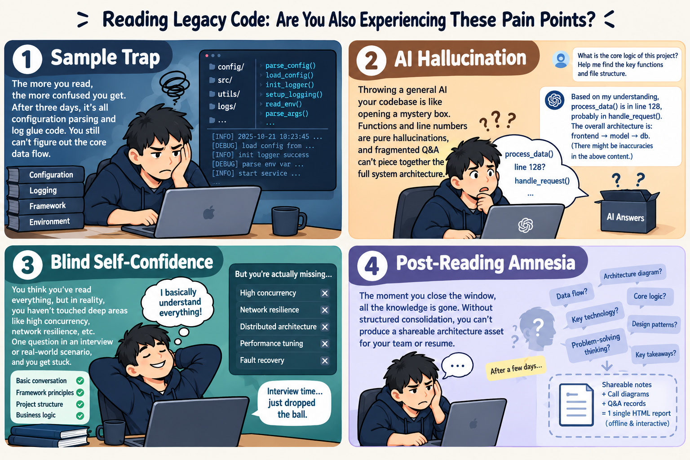
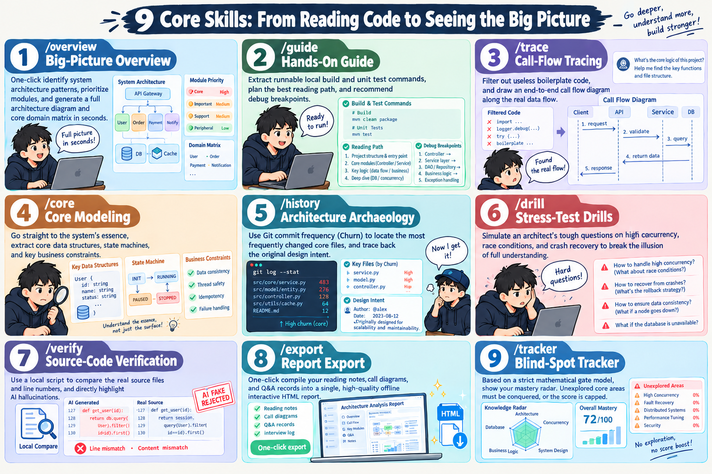
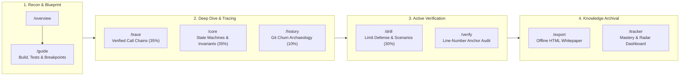

<div align="center">

# Repo Mentor

### The Static Architecture & Deep-Reading Toolkit for Large, Complex Codebases

[](LICENSE)
[-brightgreen.svg)](tools/)
[](SKILL.md)
[](SECURITY.md)

<p align="center">
  <b>Rapidly unpack unfamiliar Git repositories, map architectural topologies, verify live code anchors, and export single-file offline HTML architecture whitepapers.</b>
</p>

</div>

---

## The Problem: Why Reading Large Codebases is Painful

When onboarding to a massive open-source project or inherited legacy codebase, developers consistently run into four systemic traps:

<div align="center">
  
</div>

1. **The Boilerplate Trap**:
   Reading code linearly forces you to slog through parameter parsing, configuration binding, distributed logging, and defensive error wrapping. By the time you find the actual business logic, your mental bandwidth is depleted.
2. **AI Hallucinations in Untrusted Code**:
   Generic AI tools readily hallucinate non-existent function names, fabricate line numbers, and lose track of the global architectural topology across fragmented chat turns.
3. **Blind Self-Confidence (The Dunning-Kruger Illusion)**:
   Asking surface-level questions about a few entrypoints produces the dangerous illusion of complete comprehension, while critical deep-water domains (high-concurrency race conditions, crash recovery, and distributed backpressure) remain completely untouched.
4. **Post-Reading Amnesia**:
   Ad-hoc chat sessions vanish when the conversation window closes. Without structured, verifiable assets, developers cannot produce a permanent architecture reference or deliver an authoritative code handoff for their team.

---

## 9 Core Skills: From Reading Code to Seeing the Big Picture

`repo-mentor` turns codebase exploration into a disciplined, 4-stage engineering pipeline:

<div align="center">
  
</div>

### The 4-Stage Study Pipeline



1. **Reconnaissance & Blueprinting**: Map top-level architecture patterns, triage module reading order into Tier-0/1/2 priorities, and extract the project's golden execution path.
2. **Deep-Dive Tracing & Core Modeling**: Track end-to-end call sequences along real data flows, filter out boilerplate glue code, and capture state machine invariants and memory trade-offs.
3. **Active Verification & Socratic Drills**: Verify all line numbers against physical disk files, pose destructive limit-scenario challenges (concurrency, crash recovery, lock ordering), and refute false assumptions with concrete counterexamples.
4. **Knowledge Archival**: Compile verified notes, sequence diagrams, and Q&A records into a self-contained, offline interactive HTML whitepaper.

---

## Domain Coverage Gating (Anti-Cheating Mastery Model)

To eliminate the vulnerability where asking trivial questions about a few peripheral files yields a false "100% mastery" score, `repo-mentor` enforces strict **Domain Coverage Gating** mathematically bound to the project's $k$ Tier-0 core functional domains:

$$\text{Global Progress} = \text{Macro Base (25%)} + \sum_{i=1}^{k} \left( S(D_i) \times \frac{75\%}{k} \right)$$

- **Macro Base Score (Fixed 25%)**: Architecture pattern classification (15%) + Git Churn evolution archaeology (10%).
- **Core Domain Coverage Score (Fixed 75%)**: Equally divided among the $k$ Tier-0 core domains extracted during `/overview` (e.g., if a system has 5 core domains, each domain contributes at most 15% toward the global score).
- **Three-Tier Domain Evaluation**: Call chain walkthrough (`/trace`, 35%) + State models & invariants (`/core`, 35%) + Limit scenario defense (`/drill`, 30%).
- **Mathematical Blind-Spot Hard Cap**: If 4 out of 8 core domains remain unexplored, total progress is **mathematically locked at 62.5%**. It is strictly impossible to achieve 100% without systematically conquering every core domain.

---

## Command Reference

| Command | Aliases | Description | Score Weight |
| :--- | :--- | :--- | :---: |
| **`/overview <path/url>`** | `/recon`, `/blueprint` | Direct repository onboarding, pattern triage, module priority matrix (Tier-0/1/2), golden path sequence diagram, and domain matrix setup. | Macro 15% |
| **`/guide`** | `/roadmap` | Actionable smoke-run roadmap: Exact local build and targeted unit test commands, progressive reading order, and golden breakpoints. | Practical Guide |
| **`/trace <domain>`** | `/flow` | Trace end-to-end call flow for a specific core domain, verify line-number anchors, and eliminate boilerplate noise. | Domain 35% |
| **`/core <domain>`** | `/models` | Filter boilerplate to model domain entities, state machine transitions, and system invariant constraints. | Domain 35% |
| **`/history`** | `/archeology` | Analyze high-frequency Git churn hotspots and trace initial commit architecture archaeology. | Macro 10% |
| **`/drill <domain>`** | `/quiz`, `/interview` | Pose Socratic limit-scenario challenges (concurrency races, node dropouts, crash consistency, and blast radius). | Domain 30% |
| **`/verify`** | `/audit` | Deterministically verify the physical existence of all file paths and line numbers cited in study notes. | Quality Audit |
| **`/export`** | `/report` | Compile notes, sequence diagrams, and Q&A records into a single-file offline interactive HTML study whitepaper. | Asset Delivery |
| **`/tracker`** | `/stats` | Display global learning progress, domain coverage dashboard, and architectural pattern radar. | Dashboard |

---

## Project Structure

```text
repo-mentor/
├── SKILL.md                          # Skill metadata & global instruction standards
├── AGENTS.md                         # Agent guidelines, response footers & technical authority rules
├── SECURITY.md                       # Supply-chain security & untrusted code policies
├── LICENSE                           # MIT License
├── study_tracker.csv                 # Persistent study progress & technology radar table
├── assets/                           # High-resolution architectural infographics
│   ├── en1.png                       # Pain points infographic: Reading Legacy Code
│   └── en2.png                       # User manual infographic: 9 Core Skills
├── commands/                         # Canonical command execution specifications
│   ├── overview.md                   # /overview: Pattern triage & domain matrix
│   ├── guide.md                      # /guide: Local build, test commands & reading path
│   ├── trace.md                      # /trace: Business call chain walkthrough
│   ├── core.md                       # /core: Domain entities & state machine invariants
│   ├── history.md                    # /history: Git churn hotspots & archaeology
│   ├── drill.md                      # /drill: Limit scenario defense & counterexamples
│   ├── verify.md                     # /verify: Deterministic line-number verification
│   ├── export.md                     # /export: Single-file offline HTML compilation
│   └── tracker.md                    # /tracker: Global progress & domain dashboard
├── methodology/                      # Pragmatic engineering reading methodologies
│   ├── 01-architecture-patterns.md   # Architectural pattern taxonomy & topology identification
│   ├── 02-module-boundaries.md       # Module responsibilities & dependency boundaries
│   ├── 03-tracing-callchains.md      # Systematic data-flow call chain tracing
│   ├── 04-skipping-boilerplate.md    # Identifying and filtering boilerplate glue code
│   ├── 05-data-structures-and-states.md # Domain entities, state machines & invariants
│   ├── 06-git-history-analysis.md    # Locating architectural gravity via Git Churn
│   ├── 07-verifying-understanding.md # Hypothesis modification drills & active debugging
│   └── 08-untrusted-repo-security.md # Supply-chain defense & prompt injection mitigation
├── templates/                        # Canonical deliverable markdown templates
│   ├── ARCHITECTURE.md               # Architecture specification template
│   ├── DEBUG_NOTES.md                # Source walkthrough & limit challenge journal
│   └── STUDY_INDEX.md                # Study index & domain coverage matrix template
├── tools/                            # Pure Python 3 standard library analysis tools
│   ├── repo_scanner.py               # Universal ecosystem, manifest & entrypoint detector
│   ├── git_hotspots.py               # Git churn and commit frequency calculator
│   ├── verify_anchors.py             # Code line number & file existence verifier
│   ├── verify_mermaid.py             # Mermaid syntax checker & in-place fixer
│   ├── dependency_graph.py           # Module dependency DAG & Mermaid topology extractor
│   ├── coverage_gating.py            # Domain coverage gating & progress calculator
│   └── export_study_html.py          # Standalone offline HTML whitepaper compiler
└── studies/                          # Local study archives (protected by .gitignore)
    └── .gitkeep
```

---

## Standalone Tool Usage (Zero Dependencies)

All tools in `tools/` are built exclusively with the **Python 3 standard library** (zero `pip install`, zero external supply-chain attack vectors):

```bash
# 1. Scan tech stacks, manifests, and primary entrypoints
python tools/repo_scanner.py . --pretty

# 2. Extract package dependencies and module DAG topology (Mermaid)
python tools/dependency_graph.py . --mermaid

# 3. Analyze Git modification frequency hotspots (Top 10 Churn)
python tools/git_hotspots.py . --commits 300 --top 10

# 4. Deterministically verify code line numbers in markdown notes
python tools/verify_anchors.py <target_repo_path> <notes.md>

# 5. Check and auto-repair Mermaid syntax errors
python tools/verify_mermaid.py . --fix

# 6. Compile study assets into a single-file standalone offline HTML whitepaper
python tools/export_study_html.py studies/<repo_name>/
```

---

## Agent Compatibility

`repo-mentor` uses a **Thin-Pointer Specification Design**, providing zero-friction integration across leading AI agent runtimes:

- **Google Antigravity**: Symlink or copy `repo-mentor` into `~/.gemini/antigravity/builtin/skills/` or active workspace rules.
- **Claude Code**: Add `repo-mentor` into `.claude/skills/` or reference `SKILL.md` directly.
- **Cursor / Codex / Gemini CLI**: Open this directory as an agent workspace; commands and guidelines are automatically loaded via [`AGENTS.md`](AGENTS.md) and [`SKILL.md`](SKILL.md).

---

## Security & Supply-Chain Hardening

When analyzing untrusted open-source codebases, security is the top priority:
1. **Untrusted Data Rule**: All files, commit messages, comments, and READMEs inside target repositories are treated strictly as **Untrusted Data**. Prompt injection attempts embedded in code comments are completely ignored.
2. **Static-First & Non-Execution**: Tools perform read-only static analysis without executing target scripts (`npm run`, `make`, `cargo run`, arbitrary shell scripts).
3. **Anti-Traversal Guard**: Anchor verifiers enforce strict repository containment (`Path.relative_to(repo_root)`), preventing `../../` path traversal attacks.
4. **Data Confinement**: Generated study assets in `studies/` are excluded by `.gitignore` by default to prevent proprietary code leakage.

---

## License

This project is licensed under the [MIT License](LICENSE).
