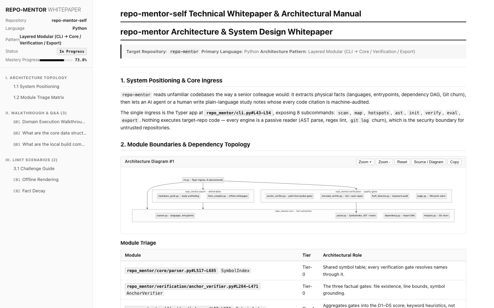

<div align="center">

# Repo Mentor

### 事实经过机器核验的代码库精读助手

<p align="center">
  <a href="README.md"><b>English</b></a> •
  <a href="README_zh.md"><b>简体中文</b></a>
</p>

[](https://github.com/Asstar-X/repo-mentor/actions)
[](https://www.python.org/)
[](LICENSE)
[](https://github.com/astral-sh/ruff)
[](https://mypy-lang.org/)
[](SKILL.md)
[](SECURITY.md)

<p align="center">
  <b>用大白话读懂陌生代码库。每一处引用，都对照磁盘上的真实文件核验过。</b>
</p>

[快速上手](#快速上手) •
[成品演示](#成品演示) •
[CLI 命令](#cli-命令参考) •
[Agent 技能](#agent-技能套件) •
[研读方法论](#研读方法论) •
[评分规则](#100-分制评分) •
[安全](#安全)

</div>

---

## 成品演示

下面这份白皮书由[本仓库自己的研读笔记](examples/repo-mentor-self/)真实编译而来——引用锚定率 100%、零幻觉、Grade A。HTML 完全自包含：断网打开，每张图照常渲染。



## 解决什么麻烦

让通用大模型解释一个五万行的陌生仓库，通常会遇到四类失望：

| 维度 | 通用 AI 总结 | Repo Mentor |
| :--- | :--- | :--- |
| **事实锚定** | 编造行号与 API 名。 | 每处引用都过磁盘核验：文件存在、行号不越界、符号真实存在（`path/to/file.py#L42-L88`）。 |
| **语气** | 空洞吹捧与营销黑话。 | 禁词检测器与"无锚定段落"检测器直接扣分，只留平实的工程语言。 |
| **执行流转** | 孤立的文件摘要。 | 拽着一个具体数据样本，从外部触发一路追到核心逻辑与最终输出。 |
| **深度** | 逐行复述"是什么"。 | 必须讲清"为什么"：取舍、状态不变式、失败模式与恢复路径。 |
| **掌握度检验** | 三道简单题带来虚假自信。 | 围绕设计意图与崩溃边界的苏格拉底式抽查，外加带幻觉罚则的 100 分制评分。 |

## 架构

一个引擎，两种接口：给人用的终端 CLI，给 AI 编程助手用的 Agent Skills 套件。智能体把确定性工作（扫描、AST 索引、核验、编译）交给 CLI 执行。

```
┌────────────────────────────────────────────────────────────┐
│  人类（CLI: repo-mentor） │  AI 智能体（SKILL.md 套件）     │
└──────────────┬───────────────────────────┬─────────────────┘
               ▼                           ▼
┌────────────────────────────────────────────────────────────┐
│                    repo_mentor 引擎                        │
│  core/          扫描器 · AST 解析 · 依赖 DAG · Git 热点    │
│  verification/  锚点门禁 · Mermaid  lint/自愈 ·            │
│                 八股检测 · 100 分制评审                    │
│  export/        研读脚手架 · 离线 HTML 编译器              │
└────────────────────────────────────────────────────────────┘
               ▲                           ▲
┌──────────────┴───────────┐  ┌────────────┴─────────────────┐
│  skills/（1 主 + 6 子）  │  │  methodology/（7 篇方法论）  │
│  templates/（3 种格式）  │  │  commands/（可选短别名）     │
└──────────────────────────┘  └──────────────────────────────┘
```

## 快速上手

### 安装

```bash
# 源码安装（PyPI 发布筹备中）：
pip install git+https://github.com/Asstar-X/repo-mentor.git

# 开发模式，含多语言 AST 支持：
git clone https://github.com/Asstar-X/repo-mentor.git
cd repo-mentor
pip install -e ".[dev,ast]"
```

### 三步走

```bash
# 1. 扫描语言、入口与测试布局
repo-mentor scan /path/to/target-repo

# 2. 把内部模块依赖画成 Mermaid DAG
repo-mentor map /path/to/target-repo --mermaid

# 3. 找出改动最频繁的文件——架构真正所在的地方
repo-mentor hotspots /path/to/target-repo --top 10
```

然后初始化研读工作区、写笔记、过门禁：

```bash
repo-mentor init studies/target-repo --repo /path/to/target-repo
repo-mentor verify /path/to/target-repo studies/target-repo --fix
repo-mentor export studies/target-repo
```

## CLI 命令参考

| 子命令 | 语法 | 说明 |
| :--- | :--- | :--- |
| `scan` | `repo-mentor scan <path> [--depth N] [--format rich\|json]` | 识别语言、框架、清单文件、入口与测试体系。 |
| `map` | `repo-mentor map <path> [--mermaid] [--internal-only] [--out FILE]` | 提取仓库内部 import 依赖，生成拓扑 DAG。 |
| `hotspots` | `repo-mentor hotspots <path> [--commits N] [--top N]` | 按 Git 变更频率排序，定位架构重心。 |
| `ast` | `repo-mentor ast <repo> <file-or-dir> [--symbols/--no-symbols] [--calls]` | 提取类、函数、签名与调用关系（Python、Go、TS、Rust）。 |
| `init` | `repo-mentor init <study-dir> --repo <repo> [--force]` | 初始化研读工作区，预填真实扫描、DAG 与热点数据。 |
| `verify` | `repo-mentor verify <repo> <notes> [--fix] [--strict]` | 核验引用的文件路径、行号边界与符号；检查并自愈 Mermaid 语法。 |
| `eval` | `repo-mentor eval <repo> <report> [--format rich\|json] [--strict]` | 用 100 分制评分研读报告。 |
| `export` | `repo-mentor export <study-dir> [--out FILE]` | 把笔记编译成完全自包含的离线 HTML 白皮书。 |

## Agent 技能套件

套件遵循 Agent Skills 规范：一个主编排技能 + 六个单一职责子技能。**技能名即命令名。**

| 技能（命令） | 视角 | 职责 |
| :--- | :--- | :--- |
| [`repo-recon`](skills/repo-recon/SKILL.md)（`/repo-recon`） | 系统全局 | 项目干啥、怎么跑起来、目录分工、阅读路线。 |
| [`repo-core`](skills/repo-core/SKILL.md)（`/repo-core <目标>`） | 向内看 | 职责、内部步骤、承重代码、边界防线。 |
| [`repo-trace`](skills/repo-trace/SKILL.md)（`/repo-trace <目标>`） | 向外看 | 真实触发场景、上下游协同、样本数据走读、异常传播。 |
| [`repo-drill`](skills/repo-drill/SKILL.md)（`/repo-drill [目标]`） | 搭档抽查 | 2~3 个直击意图、流转与崩溃边界的硬核问题，客观复盘。 |
| [`repo-verify`](skills/repo-verify/SKILL.md)（`/repo-verify`） | 质量门禁 | 引用与 Mermaid 语法的确定性核验。 |
| [`repo-export`](skills/repo-export/SKILL.md)（`/repo-export`） | 交付 | 研读笔记去重合成，编译离线白皮书。 |

### 按平台安装

```bash
# Claude Code（个人技能目录）：
git clone https://github.com/Asstar-X/repo-mentor.git ~/.claude/skills/repo-mentor

# Qoder（项目级技能）：克隆到项目的 skills 目录，
# 或安装到用户级 ~/.qoder/skills/repo-mentor
```

各平台的技能发现机制不同：有的只注册根 `SKILL.md`，有的会注册 `skills/*/SKILL.md` 全部子技能。两种方式都能用——根技能链接了全部六个子技能，按需加载。`commands/` 里的短别名（`/overview`、`/core` 等）是可选增强：喜欢的话，把它们拷进你所用平台的命令目录（如 `.claude/commands/`）。

## 研读方法论

[`methodology/`](methodology/) 里的七篇指南驱动着技能行为，按需加载而非一次性灌入：

| 指南 | 主题 |
| :--- | :--- |
| [01](methodology/01-project-overview.md) | 项目全景侦察与开箱验证 |
| [02](methodology/02-reading-core-logic.md) | 向内剖析：核心实现与承重切片 |
| [03](methodology/03-tracing-data-flow.md) | 向外追踪：链路场景与数据流转 |
| [04](methodology/04-state-and-invariants.md) | 核心数据结构与状态不变式 |
| [05](methodology/05-git-churn-hotspots.md) | Git 变更热点与演进考古 |
| [06](methodology/06-drill-and-mastery.md) | 硬核问题抽查与答辩复盘 |
| [07](methodology/07-factual-grounding-security.md) | 代码事实强锚定与沙箱安全 |

## 100 分制评分

`repo-mentor eval` 从五个维度给研读报告打分（实现见 [`judge.py`](repo_mentor/verification/judge.py)）：

| 维度 | 满分 | 计分方式 |
| :--- | :---: | :--- |
| **D1 — 事实锚定** | 35 | 引用锚定率 × 30，零幻觉再加 5；幻觉率按百分比 × 1.5 倒扣。 |
| **D2 — 架构与取舍** | 25 | 模块分流（10）、明确取舍（10）、状态不变式（5）。 |
| **D3 — 执行流转** | 20 | 黄金路径叙述（10）+ 时序图跳数核验（10）。 |
| **D4 — 语气纪律** | 15 | 零禁用词（5）、零无锚定段落（5）、FFI × 5。 |
| **D5 — Mermaid 完整性** | 5 | 通过语法检查的图表占比。 |

Fluff-Free Index（FFI）从 100 起扣：每个禁用词 -5、每个无锚定段落 -8、每处陈词结构 -4、缺取舍章节 -10。

- **Grade A**：总分 ≥ 90、零幻觉、锚定率 ≥ 95%、FFI ≥ 90。
- **Grade B**：总分 ≥ 80、零幻觉、锚定率 ≥ 90%。
- **Fail**：其余情况。`--strict` 模式下只有 Grade A 算通过。

D2/D3 用的是关键词启发式——分数是 lint 信号，不是理解力的证明。真正扛住事实底线的是确定性门禁（D1、D5）。

## 安全

分析外部仓库一律按不可信输入处理：

- **只读静态分析**：引擎绝不执行目标仓库的代码或构建钩子（`npm postinstall`、`setup.py`、Makefile）。唯一的子进程是 `git log`。
- **抗提示注入**：文件内容、提交信息、docstring 一律视为数据，绝不当作指令。
- **路径约束**：锚点解析限制在仓库根目录内，`../../` 穿越直接拒绝。
- **数据隔离**：`studies/` 默认被 gitignore，私有笔记不会混进提交。

完整安全模型见 [SECURITY.md](SECURITY.md)。

## 贡献

环境搭建、代码风格（Ruff、Mypy）与测试规范见 [CONTRIBUTING.md](CONTRIBUTING.md)。文档本身也有门禁：`tests/test_docs_smoke.py` 会把文档里的每条 CLI 示例对着真实命令树校验一遍。

## 许可

[MIT](LICENSE)。内置的第三方软件（Mermaid.js）清单见 [THIRD_PARTY_NOTICES.md](THIRD_PARTY_NOTICES.md)。