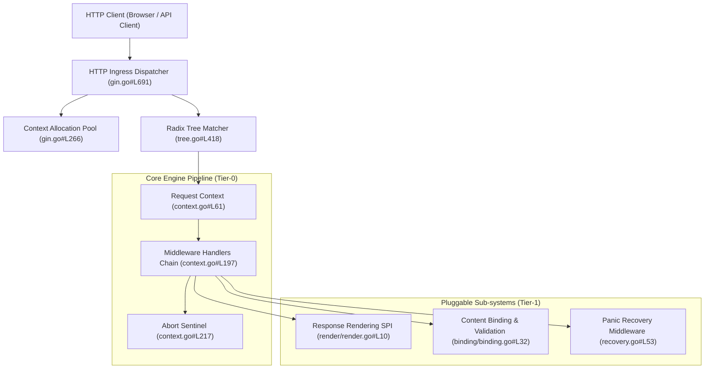
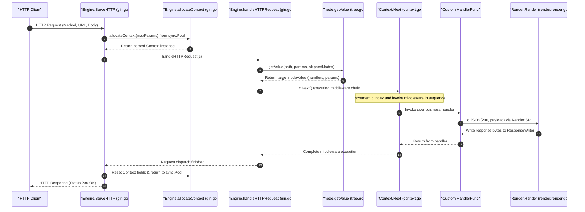
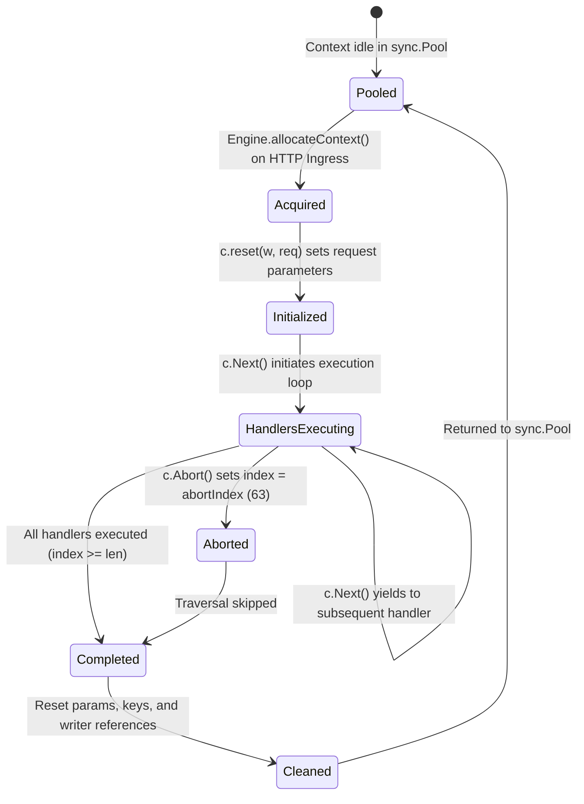

# Gin Architecture Specification (Architecture)

> Document Version: 1.0  
> Technology Stack: Go (Core HTTP Engine) / Radix Tree Routing / Zero-Allocation Pool  
> Architecture Pattern: High-Performance Microkernel + Radix Tree Router + Middleware Pipeline

---

## 1. System Overview

### Core Functionality & Positioning
[Verified Fact] Gin is a high-performance HTTP web framework written in Go (`github.com/gin-gonic/gin`). It features a custom prefix-tree (radix tree) routing engine, a contiguous middleware execution chain, and zero-allocation context recycling via `sync.Pool`. Instead of generic reflection-heavy routing, Gin compiles routes into per-HTTP-method radix trees for $O(k)$ route matching, delegating serialization and validation to pluggable internal sub-packages (`binding`, `render`).

### Architectural Topology

---

## 2. Module Responsibilities & Boundaries

| Directory / Module Path | Layer | Core Responsibility | Core Engine? | Dependency Direction |
| :--- | :--- | :--- | :---: | :--- |
| `gin.go` | Core Engine | Engine lifecycle (`New`, `Default`, `Run`, `ServeHTTP`), route trees management | **Yes (Tier-0)** | Inward; delegates to Radix router & context |
| `tree.go` | Core Routing | Compact prefix radix tree node (`node`), prefix splitting, param extraction | **Yes (Tier-0)** | Self-contained route indexing algorithm |
| `context.go` | Execution Flow | `Context` container, zero-alloc lifecycle, middleware `Next()` loop, abort guard | **Yes (Tier-0)** | Carries request state across handlers |
| `routergroup.go` | Routing Facade | Route registration API (`GET`, `POST`, `Group`), prefix path concatenation | **Yes (Tier-0)** | Wraps `Engine.addRoute` with URL groups |
| `render/` | Rendering SPI | Multi-format response serialization (`JSON`, `ProtoBuf`, `HTML`, `MsgPack`) | **Tier-1** | Outward; implements `Render` interface |
| `binding/` | Binding SPI | Multi-format body parsing and struct tag validation (`JSON`, `Form`, `Query`) | **Tier-1** | Decodes input payloads into Go structs |
| `recovery.go` | Resilience | Safe panic interceptor, stack trace capture, and 500 error bubbling | **Tier-1** | Built-in recovery middleware |
| `logger.go` | Observability | Structured request logging, timing calculation, and status code output | **Tier-1** | Built-in observability middleware |
| `internal/bytesconv/` | Performance | Zero-copy byte slice to string conversion (`StringToBytes`, `BytesToString`) | **Tier-2** | Low-level unsafe string conversion helper |
| `internal/fs/` | Utility | Static file server adapter and path normalization | **Tier-2** | Standard library `http.FileSystem` wrapper |

---

## 3. Key Call Chains

### Golden Path Scenario: HTTP Ingress Routing & Middleware Pipeline (`Engine.ServeHTTP`)

### Verified Code Anchors
- Ingress Server Entrypoint: [`gin.go#L691-L708`](file:///tmp/benchmark-repos/gin/gin.go#L691-L708)
- Context Pool Allocator: [`gin.go#L266-L272`](file:///tmp/benchmark-repos/gin/gin.go#L266-L272)
- HTTP Request Dispatcher: [`gin.go#L719-L745`](file:///tmp/benchmark-repos/gin/gin.go#L719-L745)
- Radix Tree Search Engine: [`tree.go#L418-L535`](file:///tmp/benchmark-repos/gin/tree.go#L418-L535)
- Middleware Chain Traversal: [`context.go#L197-L215`](file:///tmp/benchmark-repos/gin/context.go#L197-L215)
- Context Abort Sentinel: [`context.go#L217-L225`](file:///tmp/benchmark-repos/gin/context.go#L217-L225)
- Response Rendering SPI Contract: [`render/render.go#L10-L18`](file:///tmp/benchmark-repos/gin/render/render.go#L10-L18)
- Panic Recovery Middleware: [`recovery.go#L53-L75`](file:///tmp/benchmark-repos/gin/recovery.go#L53-L75)

---

## 4. Core Data Structures & State Machines

### Core Entities
- `Engine`: [`gin.go#L99-L140`](file:///tmp/benchmark-repos/gin/gin.go#L99-L140) — Core router orchestrator managing radix trees by HTTP method, pool of `Context` pointers, configuration flags, and fallback handlers (`noRoute`, `noMethod`).
- `node`: [`tree.go#L99-L125`](file:///tmp/benchmark-repos/gin/tree.go#L99-L125) — Radix tree trie node holding edge prefix `path`, branch child nodes `children`, priority count `priority`, parameter wildcard classification `wildChild`, and pre-compiled handler chain `handlers`.
- `Context`: [`context.go#L61-L90`](file:///tmp/benchmark-repos/gin/context.go#L61-L90) — Request context struct holding raw request pointer `Request`, underlying response writer wrapper `Writer`, route parameters `Params`, registered middleware chain `handlers`, and index cursor `index`.
- `Render`: [`render/render.go#L10-L18`](file:///tmp/benchmark-repos/gin/render/render.go#L10-L18) — Common interface for HTTP body serializers enforcing `Render(http.ResponseWriter) error` and `WriteContentType(http.ResponseWriter)`.

### State Machine Transitions: Request Context Lifecycle

---

## 5. Architecture Design Trade-offs & Critical Defenses

### 5.1 Architectural Trade-offs
1. **Radix Tree Routing vs Hash / Regex Dispatchers**:
   - *Design Choice*: Gin compiles routes into strict prefix trees (`tree.go#L99`) rather than regular expressions (`regexp`) or flat URL maps.
   - *Advantage*: Lookups operate in $O(k)$ time where $k$ is URL length, without allocating memory on heap during path traversal.
   - *Cost & Limitation*: Wildcard and catch-all routes cannot overlap with conflicting static sibling routes on the same path segment, necessitating upfront route tree validation during `addRoute`.
2. **`sync.Pool` Context Recycling vs Automatic Garbage Collection**:
   - *Design Choice*: `Context` instances are pooled via `sync.Pool` in `gin.go#L266` and cleared after each HTTP request.
   - *Advantage*: Eliminates thousands of short-lived allocations per second under high concurrency (100k+ RPS).
   - *Cost & Limitation*: Asynchronous goroutines spawned inside a handler cannot safely retain the raw `*gin.Context` pointer, and must explicitly call `c.Copy()` (`context.go#L125`) to prevent data corruption when the pool recycles the struct.
3. **Index Cursor Middleware Chain vs Recursive Callbacks**:
   - *Design Choice*: Handlers are stored in a contiguous slice `HandlersChain` and invoked by iterating `c.index++` in `context.go#L197`.
   - *Advantage*: Zero recursion call-stack overhead, minimal cache misses, and trivial abort logic (`c.index = abortIndex`).
   - *Cost & Limitation*: Middleware cannot intercept returned errors from subsequent handlers via standard return values, requiring shared mutation via `c.Errors` or `c.Writer.Status()`.

### 5.2 Failure Modes & Boundary Defenses
- **Panic Interception & Graceful Degrade**: The `Recovery` middleware (`recovery.go#L53`) catches unhandled panics, prints formatted stack traces to stderr, and writes HTTP 500 status to the client, preventing process crashes.
- **Slowloris Header Attack Protection**: The default `Engine.Run` configures `defaultReadHeaderTimeout = 10 * time.Second` (`gin.go#L37`), mitigating HTTP slowloris resource exhaustion.
- **Max Multipart Memory Threshold**: Uploaded multi-part payloads are capped by `defaultMultipartMemory = 32 << 20` (32MB) in `gin.go#L28`, buffering excess bytes to temporary disk files to prevent memory exhaustion.
- **Infinite Middleware Loop Defense**: `c.Abort()` immediately sets `c.index = abortIndex` (`63`), preventing out-of-bounds execution.
