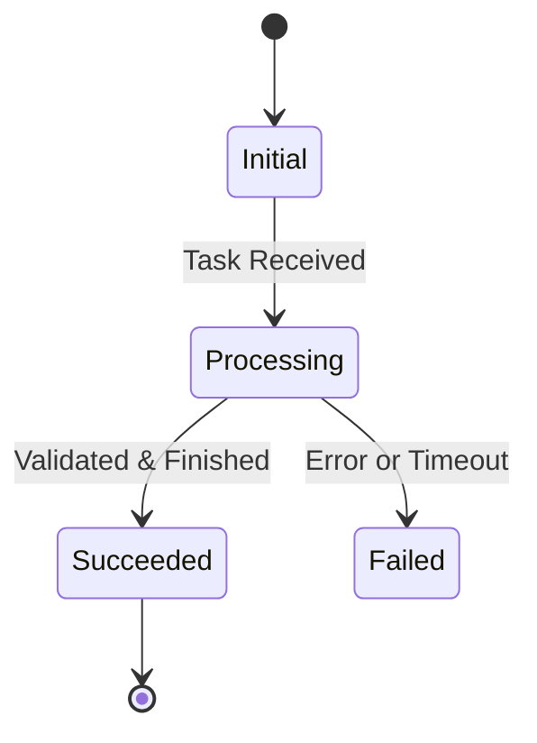

# /core (Alias: /models) — Core Entities, State Machines & Invariants

Focuses on a designated core functional domain (e.g. `/core pkg/storage` or `/core scheduler_entities`), filtering boilerplate glue code to model critical data entities, state machine transitions, and system invariants.

---

## Operational Steps

### 1. Map to Target Functional Domain
- Confirm which domain $D_i$ in the Core Functional Domain Matrix this command corresponds to.
- If the domain's state model is already analyzed, notify the user that its score is saturated (35%) and recommend limit drills or switching to an unexplored blind spot.

### 2. Filter Boilerplate Noise
Adhere to `methodology/04-skipping-boilerplate.md`:
- Omit CLI argument flags and environment variable loading;
- Omit repetitive error handling wrappers and tracing spans;
- Omit boilerplate struct copying and DTO field mappings.

### 3. Output Core Modeling Report
Adhere to `methodology/05-data-structures-and-states.md`:

#### I. Core Entity Definitions
Display 2–3 key struct/class definitions carrying the primary business logic (with verified line-number links):
- Explain the business purpose and modeling intent of each core field;
- Note whether fields are immutable, guarded by mutexes, or subject to memory pool constraints.

#### II. State Machine Transitions
If tasks or requests follow a lifecycle state machine, diagram with Mermaid:

> **Notice**: Never use C++ `::` scope operators in transition labels (use `.` instead, e.g. `AllocStatus.NEVER`) to prevent Mermaid parser errors. Code blocks must be flush with margin.
Specify which state transitions are illegal and where the code defends against invalid transitions.

#### III. System Invariants
List 2–3 fundamental invariant rules that must never be violated, highlighting where locks, transactional commits, or assertions enforce them.

#### IV. Architectural Trade-offs
Objectively analyze the engineering trade-offs chosen by the authors (e.g. resident memory vs. zero allocation, strict consistency vs. throughput).

---

### 4. Archival & Matrix Update
1. Save analysis into `studies/<repo_name>/DEBUG_NOTES.md`.
2. Update the **Domain Coverage Matrix** in `studies/<repo_name>/README.md`:
   - Mark `State Model (/core)` for domain $D_i$ as `35%`;
   - Recalculate domain score $S(D_i)$ and global mastery progress.
3. Synchronize `study_tracker.csv`.

---

### Mastery Progress & Blind-Spot Analysis
- **Global Mastery Progress**: **[Calculated Value]%**
- **Core Domain Coverage**: **m / k**
- **Blind-Spot Warning**:
  - [List remaining unexplored Tier-0 domains]
  > Gating Notice: Mastery progress remains capped until all core domains are walked through and modeled.

### Recommended Next Steps
1. **`/drill <Current Domain>`** — Stress-test edge cases, concurrency races, and invalid state transitions.
2. **`/trace <Unexplored Domain>`** — Switch to an untouched core domain.
3. **`/history`** — Investigate the evolution and refactoring history of these core data models.
