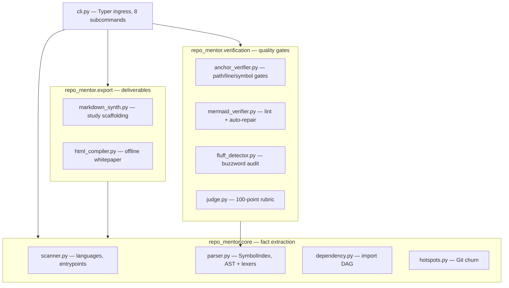

# repo-mentor Architecture & System Design Whitepaper

> **Target Repository**: `repo-mentor`
> **Primary Language**: Python
> **Architecture Pattern**: Layered Modular (CLI → Core / Verification / Export)

---

## 1. System Positioning & Core Ingress

`repo-mentor` reads unfamiliar codebases the way a senior colleague would: it extracts physical facts (languages, entrypoints, dependency DAG, Git churn), then lets an AI agent or a human write plain-language study notes whose every code citation is machine-audited.

The single ingress is the Typer app at [repo_mentor/cli.py#L43-L101], exposing 8 subcommands: `scan`, `map`, `hotspots`, `ast`, `init`, `verify`, `eval`, `export`. Nothing executes target-repo code — every engine is a passive reader (AST parse, regex lint, `git log` churn), which is the security boundary for untrusted repositories.

## 2. Module Boundaries & Dependency Topology

### Module Triage

| Module | Tier | Architectural Role |
| :--- | :---: | :--- |
| [repo_mentor/core/parser.py#L461-L542] `SymbolIndex` | Tier-0 | Shared symbol table; every verification gate resolves names through it. |
| [repo_mentor/verification/anchor_verifier.py#L122-L308] `AnchorVerifier` | Tier-0 | The three factual gates: file existence, line bounds, symbol grounding. |
| [repo_mentor/verification/judge.py#L53-L252] `RubricJudge` | Tier-1 | Aggregates gates into the D1–D5 score; keyword heuristics, not semantics. |
| [repo_mentor/export/html_compiler.py#L340-L400] `build_full_html_page` | Tier-1 | Single f-string template; inlines the vendored Mermaid bundle. |

## 3. High-Churn Architectural Hotspots

Live `repo-mentor hotspots` output at study time (300 commits window):

| File Path | LOC | Churn (Ins+Del) | Revisions | Hotspot Score |
| :--- | :---: | :---: | :---: | :---: |
| `SKILL.md` | 52 | 1088 | 15 | 7552.8 |
| `README.md` | 264 | 816 | 11 | 6597.4 |
| `AGENTS.md` | 60 | 886 | 13 | 5894.2 |
| `repo_mentor/export/html_compiler.py` | 952 | 1021 | 3 | 5275.5 |
| `repo_mentor/verification/anchor_verifier.py` | 649 | 651 | 2 | 2595.2 |

Reading order signal: the prompt layer (`SKILL.md` / `AGENTS.md` / `README.md`) churns most — the product is still tuning its voice; the verification engine is the stable load-bearing wall.

## 4. System Invariants & Trade-Offs

1. **Read-only invariant**: no engine imports or executes target-repo code; `git log` is the only subprocess. Trade-off: no runtime truth (call graphs are static approximations).
2. **Deterministic gates, heuristic judge**: file/line/symbol checks are exact; D2/D3 rubric dimensions are keyword regexes ([repo_mentor/verification/judge.py#L165-L194]). Trade-off: cheap and reproducible, but a cleverly worded empty doc can score points — the gates, not the judge, carry the factual burden.
3. **Single-file HTML via one f-string**: every JS brace is doubled. Trade-off: zero template-engine dependency for the page shell, at the cost of readability — the reason `_load_mermaid_js` injects the bundle as a single placeholder instead of inlining it into the template body.