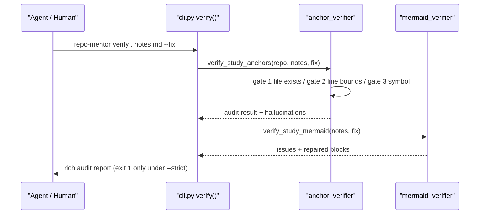

# Verify Pipeline — End-to-End Trace

## 1. Real Trigger Scenario

An agent finishes writing `studies/acme/traces/parser_trace.md` and runs the quality gate before delivery. The upstream trigger is the `/repo-verify` skill workflow (or a human in the terminal); the downstream consumer is the export compiler, which refuses to ship unverified notes.

## 2. Upstream / Downstream Topology

- Upstream ingress: [repo_mentor/cli.py#L292-L327] `verify()` — two engine calls, rich tables, strict gating.
- Anchor fan-out: [repo_mentor/verification/anchor_verifier.py#L566-L570] `verify_study_anchors()` accepts a file or a directory (`rglob("*.md")`).
- Per-citation gates: [repo_mentor/verification/anchor_verifier.py#L342-L346] `AnchorVerifier.verify_item()`.
- Diagram lint/repair: [repo_mentor/verification/mermaid_verifier.py#L246-L250] `verify_study_mermaid()` → [repo_mentor/verification/mermaid_verifier.py#L141-L145] `repair_mermaid_code()`.

## 3. Sample Walkthrough

Input note contains a citation claiming lines 999–1000 of `repo_mentor/cli.py` (the file has ~360 lines) and a diagram node `A[API Gateway (8080)]`.

- Before: anchor claims lines `999–1000`; diagram label has unquoted parens.
- Processing: gate 2 rejects the out-of-bounds span → logged as a hallucination; mermaid lint flags the unquoted label → `--fix` rewrites it to `A["API Gateway (8080)"]` in place.
- After: the note on disk has a healed diagram; the audit report lists the dead anchor for the author to re-cite. Nothing is silently patched into a fake `#L` reference.

## 4. Failure Behavior

Missing engine imports degrade to a notice panel (exit 0); `--strict` flips any gate failure into exit 1, which is what CI and the export workflow rely on. Errors never mutate the target repository — repairs only touch the study notes.