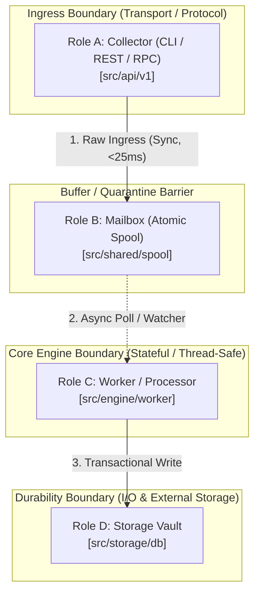

# 01. Architectural Pattern Recognition & Macro Layering (5-Level Cognitive Zooming)

## Objective
Establish an engineering-grade methodology for identifying the macro architectural pattern of an unfamiliar codebase through the **5-Level Cognitive Zooming** framework (Why ➔ Strategy ➔ Example ➔ Deep-Dive ➔ Takeaway). 

Ground top-level comprehension first in **problem space, real-world pain, and fundamental tension**, then map into **character roles and invariants**, completely eliminating premature line-number dumps and artificial "AI-flavor" abstractions.

---

## 1. Cognitive Rule Zero: Never Dump Lines Before Problem Space
A fatal failure mode in AI-generated architecture reports is jumping straight to micro-level file lines and call stacks before explaining **why the project exists**.

### The 2 Immutable Cognitive Constraints for Level 1 & 2:
1. **Forbidden in Level 1 (Why)**: No internal source filenames, no function names, and no line numbers. Explain the real-world pain, the core mission, and the first-principles engineering tension in pure, uncompromising human language.
2. **Forbidden in Level 2 (Strategy)**: No microscopic implementation lines or system call details. Focus strictly on:
   - **The Real-World Metaphor** (e.g. "a stenographer in the terminal + a background executive secretary + a local vault");
   - **The Cast of Characters** (3~5 core role definitions mapped to top-level directories);
   - **The Coarse-Grained Flowchart**.

---

## 2. Defining Problem Space & First-Principles Tension (Level 1)

Every software project is born out of a specific engineering agony. To understand its architecture, identify:

### 2.1 The Real-World Agony (What pain forced this code into existence?)
- What repetitive, error-prone, or computationally prohibitive obstacle did developers face without this tool?
- What is its **Black-Box Contract**?
  - Ingress: What raw input enters the boundary?
  - Egress: What final output is delivered?
  - Invariant Side-Effect: What state mutation does it leave behind?

### 2.2 The First-Principles Tension (The Engineering Dilemma)
Architectural complexity is not accidental; it is forced by conflicting constraints. Every codebase attempts to balance a core tension:
- `Extreme Low Latency` **vs** `Durable Crash Resilience`
- `Ephemeral Stateless Client` **vs** `Long-Term Semantic Memory`
- `Zero External Dependencies` **vs** `Rich Multi-Format Capability`

> **Rule**: When analyzing an architecture, ask: *"What disaster happens if we implement this with a naive 30-line script?"* The answer to that question reveals the true load-bearing pillars of the architecture.

---

## 3. The Cast of Characters & Macro Topologies (Level 2)

### 3.1 Foundational Architectural Topologies

| Architectural Topology | Primary Constraint Solved | Codebase Signatures (Files & Symbols) | Runtime Control & Data Flow |
| :--- | :--- | :--- | :--- |
| **Microkernel / Plugin** | Extensibility without core recompilation | Extension registry, lifecycle hooks (`RegisterPlugin`, `Hook`, `OnEmit`), discovery SPI | Core runtime boots minimal event bus; dynamic modules hook into lifecycle pivots. |
| **Pipes & Filters** | Unidirectional data transformation | Discrete stage interfaces (`Transform`, `NextStage`, `Lex`, `Parse`), immutable tokens/buffers | Data flows linearly through chained stage buffers; backpressure gates stage throughput. |
| **WAL + State Machine** | Crash durability & strict consistency | Write-Ahead Log (`AppendEntry`, `wal.go`), snapshotting (`Compact`), deterministic replay | Ingress appends to sequential disk log before in-memory state transition commits. |
| **Event-Driven / Actor** | High-throughput concurrent isolation | Message mailboxes (`chan Msg`, `Receive`), event buses, decoupled dispatchers | Senders yield messages to asynchronous mailboxes; actors mutate private state in isolation. |
| **Clean / Layered DDD** | Isolation of core domain from transport/DB | Pure entities without I/O imports, repository interfaces (`IRepository`), dependency inversion | Transport calls domain use-cases; domain invokes outward storage via abstract interfaces. |
| **Workflow Orchestrator** | Multi-step distributed task execution | DAG scheduling, task state machines, retry policies, distributed leases | Orchestrator parses declarative spec, commits steps to storage, and polls/dispatches workers. |

### 3.2 The Cast of Characters Table
Rather than reciting file listings, map the system into a small theatrical cast:

| Role Name | Human Persona | Single Core Responsibility | Mapped Directory | Process / Boundary |
| :--- | :--- | :--- | :--- | :--- |
| **Role A** | The Collector | Captures raw events, verifies protocol, exits immediately | `src/cli/` | Short-lived process |
| **Role B** | The Mailbox | Buffers events atomically without memory corruption | `src/shared/spool/` | Disk filesystem queue |
| **Role C** | The Worker | Asynchronously processes, deduplicates, and classifies | `src/services/worker/` | Long-running daemon |
| **Role D** | The Vault | Provides durable indexing, retrieval, and schema persistence | `src/services/storage/` | SQLite / RocksDB / Disk |

---

## 4. Production Macro Topology Standard

When documenting macro topology in `ARCHITECTURE.md`, use the following validated Mermaid pattern with explicit protocol barriers and participant roles:

---

## 5. Negative Anti-Patterns to Eliminate

### ❌ N1: Directory Parroting (目录机械复述)
- **Symptom**: Iterating through top-level directories and translating folder names into literal explanations (e.g., "*`utils/` stores utilities, `controllers/` handles controllers*").
- **Remedy**: Translate every directory into its **Character Role** and **Data Ownership**.

### ❌ N4: Phony Static Boxes (静态假架构图)
- **Symptom**: Drawing a Mermaid box diagram where nodes are merely high-level names and arrows possess no dynamic semantics.
- **Remedy**: Every arrow must declare:
  1. Sequence number;
  2. Protocol or transition mechanism (`IPC`, `fsync`, `HTTP POST`);
  3. Directional data mutation.

### ❌ N9: Premature Grounding Overload (认知早熟/强行下沉代码行)
- **Symptom**: Forcing line numbers and function calls on the reader before defining the system's real-world pain point, metaphor, and character roles.
- **Remedy**: Enforce strict quarantine: No microscopic line numbers in Level 1 and Level 2.
