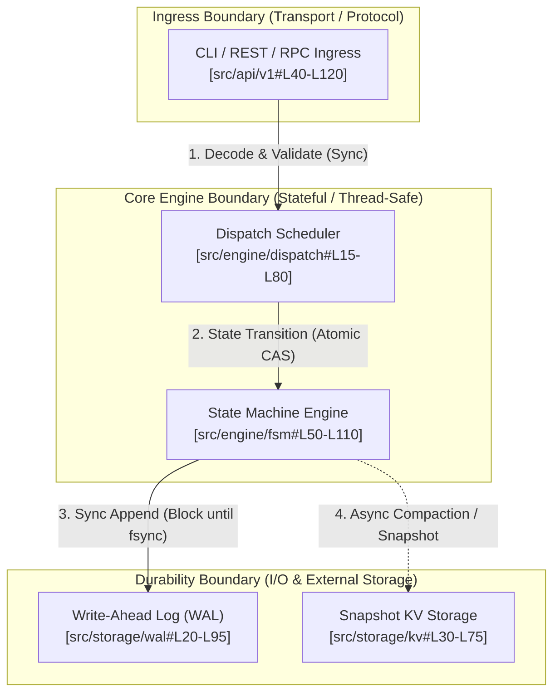

# 01. Architectural Pattern Recognition & Macro Layering

## Objective
Establish an engineering-grade methodology for identifying the macro architectural pattern of an unfamiliar codebase. Ground top-level comprehension in structural invariant evidence rather than superficial folder names, and eliminate artificial "AI-flavor" abstractions.

---

## 1. Architectural Topologies & Structural Signatures

Software architectures converge on a small set of foundational topologies driven by their primary engineering constraints:

| Architectural Topology | Primary Constraint Solved | Codebase Signatures (Files & Symbols) | Runtime Control & Data Flow |
| :--- | :--- | :--- | :--- |
| **Microkernel / Plugin** | Extensibility without core recompilation | Extension registry, lifecycle hooks (`RegisterPlugin`, `Hook`, `OnEmit`), discovery SPI | Core runtime boots minimal event bus; dynamic modules hook into lifecycle pivots. |
| **Pipes & Filters** | Unidirectional data transformation | Discrete stage interfaces (`Transform`, `NextStage`, `Lex`, `Parse`), immutable tokens/buffers | Data flows linearly through chained stage buffers; backpressure gates stage throughput. |
| **WAL + State Machine** | Crash durability & strict consistency | Write-Ahead Log (`AppendEntry`, `wal.go`), snapshotting (`Compact`), deterministic replay | Ingress appends to sequential disk log before in-memory state transition commits. |
| **Event-Driven / Actor** | High-throughput concurrent isolation | Message mailboxes (`chan Msg`, `Receive`), event buses, decoupled dispatchers | Senders yield messages to asynchronous mailboxes; actors mutate private state in isolation. |
| **Clean / Layered DDD** | Isolation of core domain from transport/DB | Pure entities without I/O imports, repository interfaces (`IRepository`), dependency inversion | Transport calls domain use-cases; domain invokes outward storage via abstract interfaces. |
| **Workflow Orchestrator** | Multi-step distributed task execution | DAG scheduling, task state machines, retry policies, distributed leases | Orchestrator parses declarative spec, commits steps to storage, and polls/dispatches workers. |

---

## 2. Real Architecture vs. Superficial Directory Structure

A major symptom of shallow AI analysis is mistaking directory names for architectural truth:
- **The "Plugin" Illusion**: A repository contains a directory named `plugins/`, but every file is statically imported into `main.py` via hardcoded `switch` statements. This is **monolithic dispatch**, not a true microkernel. True microkernels provide dynamic discovery, contract interfaces, and decoupled lifecycles.
- **The "Clean Architecture" Illusion**: A project defines `controllers/`, `services/`, and `models/`, but service methods execute raw SQL strings directly and controller objects leak HTTP session structs deep into domain math. This is a **procedural monolith**, not layered architecture.
- **The "Event-Driven" Illusion**: An application defines event classes, but every event publisher immediately calls `await handler.handle(event)` synchronously within an ambient database transaction. This is **synchronous observer wiring**, lacking true message buffering or actor isolation.

### Verification Rule: Look for the Structural Invariants
Before declaring an architecture pattern, inspect:
1. **Entrypoint Instantiation**: How are dependencies assembled in `main()` / bootstrap files? Are components instantiated via factory registries, dependency injection containers, or static singletons?
2. **Interface Abstraction**: Does the domain engine import third-party client libraries (e.g., `redis`, `boto3`, `pgx`) directly, or does it call an abstract storage contract?
3. **Boundary Crossings**: Where do network/process hops occur? Mark boundaries where synchronous RPC transitions to asynchronous message queues or worker pools.

---

## 3. Negative Anti-Patterns to Eliminate

### ❌ N1: Directory Parroting (目录机械复述)
- **Symptom**: Iterating through top-level directories and translating folder names into literal explanations (e.g., "*`utils/` stores utilities, `controllers/` handles controllers, `models/` contains data models*").
- **Engineering Verdict**: Zero information gain. A software engineer can read directory names in 2 seconds. The report must explain **how components interact**, **why dependencies flow in a specific direction**, and **where algorithmic gravity resides**.
- **Gate Rule**: If any section lists directories without identifying their priority tier, dependency direction, and core/glue classification, it is rejected.

### ❌ N4: Phony Static Boxes (静态假架构图)
- **Symptom**: Drawing a Mermaid box diagram where nodes are merely high-level names and arrows possess no dynamic semantics (neither call sequence, nor data mutation, nor protocol boundaries).
- **Engineering Verdict**: Static boxes without protocol labels or flow directions fail to assist debugging or operational tracing.
- **Gate Rule**: Every architectural topology diagram **MUST** explicitly delineate:
  - Protocol boundaries (e.g., `HTTP/gRPC/CLI Ingress`);
  - Process/thread boundaries (e.g., `IPC/Channel/Thread-Pool Hop`);
  - Directed data mutation flow (e.g., `Raw Payload -> Validated DTO -> Domain Entity -> WAL Entry`).

---

## 4. Production Macro Topology Standard

When documenting macro topology in `ARCHITECTURE.md`, use the following validated Mermaid pattern with explicit protocol barriers and participant roles:

---

## 5. Verification Checklist

Before finalizing macro architecture conclusions, verify:
- [ ] Is the classified pattern justified by physical code symbols (e.g., `AppendEntry`, `PipelineStage`, `PluginRegistry`) rather than directory names?
- [ ] Are protocol, network, and process boundaries clearly identified in the topology diagram?
- [ ] Are directory parroting (N1) and phony static boxes (N4) completely absent?
- [ ] Does every major node cite at least one verified file and line range anchor?
