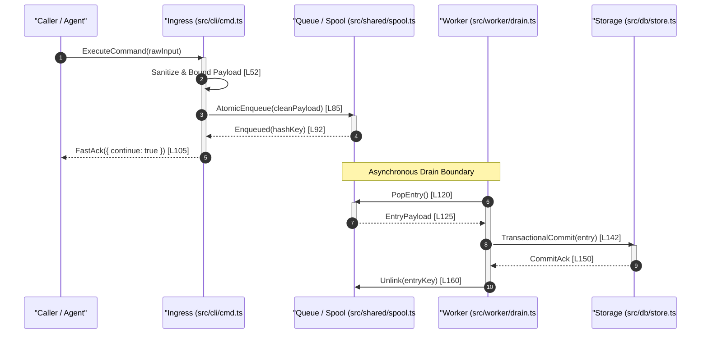

# 03. Systematic Call-Chain Tracing (From Concrete Data Journey to Code Anchors)

## Objective
Establish an execution-first methodology for tracing critical end-to-end paths through an unfamiliar codebase. 

Enforce the **Level 3 Cognitive Rule**: Never trace code lines in a vacuum. First define a **concrete, single-case data journey (A Day in the Life of Data)** with real inputs and payload diffs, then follow the 5-Phase Golden Path across boundaries with AST-verified code anchors.

---

## 1. Cognitive Rule: Ground the Trace in a Concrete Scenario

Tracing execution without an actual, concrete piece of data produces sterile, disconnected diagrams that readers immediately forget.

### The Mandatory 2-Step Tracing Standard:
1. **Step A: The Concrete Data Scenario (Level 3)**
   - Declare one exact, realistic input event (e.g., a specific CLI invocation with flags, an exact HTTP payload, or a specific test failure message).
   - Trace how that specific payload transforms, shrinks, or expands as it passes between the system's character roles.
2. **Step B: The 5-Phase Golden Path & Code Anchors (Level 4)**
   - Map each stage of the data transformation to physical files, functions, and line ranges.

---

## 2. The 5-Phase Golden Path Architecture

Every meaningful data journey traverses five canonical phases:

$$\text{Phase 1: Ingress} \longrightarrow \text{Phase 2: Dispatch} \longrightarrow \text{Phase 3: Engine} \longrightarrow \text{Phase 4: Persistence/IO} \longrightarrow \text{Phase 5: Response}$$

```
[Concrete Input Payload]
       │
       ▼
┌──────────────┐   Decode / Validate DTO & Sanitize Oversized Fields
│ 1. Ingress   │ ────────────────────────────────────────┐
└──────────────┘                                         ▼
                                                  ┌──────────────┐
                                                  │ 2. Dispatch  │ Route, Hash & Buffer
                                                  └──────────────┘
                                                         │
                                                         ▼
                                                  ┌──────────────┐
                                                  │  3. Engine   │ State Transition & Intelligence
                                                  └──────────────┘
                                                         │
                                                         ▼
┌──────────────┐   Format Output & Ack            ┌──────────────┐
│ 5. Response  │ ◄─────────────────────────────── │ 4. Persist/IO│ Sync Fsync & Relational Commit
└──────────────┘                                  └──────────────┘
```

### Phase Responsibilities & Data Diff Tracking:

1. **Phase 1: Ingress (Transport & Protocol Parsing)**
   - Entrypoints: CLI command handler, HTTP route handler, gRPC service, or message queue consumer.
   - Operations: Raw byte stream decoding, header parsing, syntactic schema validation.
   - **Data Diff**: Raw outside bytes ➔ Sanitized in-memory object (stripped of dangerous/oversized blobs).
2. **Phase 2: Dispatch (Routing & Queue Buffering)**
   - Operations: Rate limiting, hash-key calculation, isolation buffering (e.g. temporary spool file, actor mailbox).
   - **Data Diff**: Sanitized object ➔ Persisted queue entry stamped with monotonic epoch timestamp.
3. **Phase 3: Engine (Core Domain Computation)**
   - Operations: Invariant assertions, state machine transition checks, LLM prompt assembly, algorithmic scheduling.
   - **Data Diff**: Raw events ➔ Semantic domain entities and structured insights.
4. **Phase 4: Persistence / Outbound I/O (Durability & Side Effects)**
   - Operations: WAL disk append with `fsync`, database transactional commit, remote RPC emission, cache invalidation.
   - **Data Diff**: Transient domain entity ➔ Durable relational record with indices and hashes.
5. **Phase 5: Response / Receipt (Receipt Generation & Fast Ack)**
   - Operations: Result status serialization, telemetry counter increment, error envelope wrapping, client ack.
   - **Data Diff**: Internal status ➔ Minimal client response DTO (e.g. `{ "continue": true }`).

---

## 3. Crossing Boundary Hops: Sync vs. Async Execution

Complex systems rarely execute linearly on a single thread. When tracing call chains, explicitly identify and label boundary crossings:

| Boundary Type | Manifestation in Code | Trace Strategy & Critical Gotchas |
| :--- | :--- | :--- |
| **Sync Function Call** | `res = engine.Process(ctx, req)` | Follow direct stack frame. Note caller lock acquisitions before entry. |
| **Async Task Spawn** | `go worker.Run()`, `asyncio.create_task()`, `tokio::spawn` | The current thread/goroutine relinquishes execution. Trace where the future/channel is awaited. |
| **Channel / Queue Hop** | `ch <- task`, `queue.push(item)` | Identify buffer size. Is it bounded (backpressure) or unbounded (OOM hazard)? Identify consumer loop. |
| **Process / File Spool Hop** | `atomicWrite(temp, final)`, `nudgeWorker()` | Trace inter-process communication (IPC, file watch, socket). |
| **Network / RPC Hop** | `client.Do(req)`, `grpc.Invoke()` | Note timeout deadline, circuit breaker wrapping, and idempotent retry policies. |

---

## 4. Negative Anti-Pattern to Eliminate

### ❌ N5: Happy Path Bias (快乐路径偏见)
- **Symptom**: Describing an execution trace as if every network call succeeds instantly, every lock is acquired without contention, inputs are always valid, and crashes never occur.
- **Remedy**: Every call chain trace **MUST** document:
  - At least one critical failure/rejection branch (e.g., validation failure, lock timeout, disk full);
  - How errors bubble up through the stack (error wrapper, panic recovery, or silent drop);
  - State cleanup or rollback mechanisms triggered upon failure.

---

## 5. Mermaid Sequence Diagram Standard

All call-chain diagrams in `traces/<scenario>.md` and `ARCHITECTURE.md` must follow these syntax and annotation rules:
1. **Flush Margins**: Code block starts flush left with ````mermaid` without list indentation.
2. **Quoted Participant Aliases**: Always declare participants with quoted names and file anchors.
3. **Anchor Every Major Arrow**: Every inter-module transition must specify the exact source file and line range where the invocation occurs.


