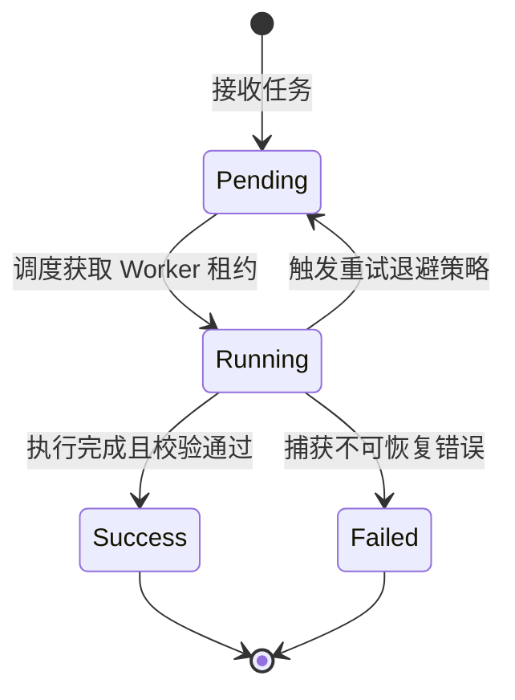

# 04. 核心数据结构与状态不变式

## 目标
建立对核心数据实体、状态突变与系统不变式的建模方法论。探究软件系统内存布局与持久化状态背后的基本真理，梳理状态机的生命周期转移、并发互斥边界与崩溃一致性保障。

---

## 1. 数据结构决定逻辑走向

如 Linus Torvalds 所言：“烂程序员关心代码，好程序员关心数据结构及其关系”。  
如果搞不清核心数据结构长什么样，代码逻辑就会显得像一团散沙；一旦看透了核心实体与状态转移，上层纷繁复杂的控制流就会瞬间变得顺理成章。

---

## 2. 状态不变式 (System Invariants)

在阅读承重代码时，最重要的不是看常规赋值，而是识别**系统在任何时刻都誓死维护的不变式规则**：

1. **数值与单调性不变式**：
   - 例如：日志序列号（LSN）必须严格单调递增；已提交位点永远不得大于最新写入位点。
2. **状态互斥与排他不变式**：
   - 例如：一个任务的状态不能同时处于 `RUNNING` 和 `TERMINATED`；临界区内部在同一时刻只能有一个协程持有修改权。
3. **结构引用一致性不变式**：
   - 例如：双向链表的节点前驱后继指针闭环；树结构的父子节点引用计数平衡。

---

## 3. 有限状态机 (FSM) 生命周期建模

系统中的常驻实体通常具有明确的生命周期状态迁移。使用 Mermaid 状态图（`stateDiagram-v2`）进行建模：

在审视状态机时，重点检查：
- **是否存在非法状态转移？**（比如直接从 `Pending` 跃迁到 `Success`）；
- **是否存在卡死的中间死锁态？**（Worker 崩溃后租约未释放导致永远 `Running`）。

---

## 4. 并发访问与竞争边界

当状态在多线程、多协程或多进程并发环境中被修改时，审视系统的同步原语：
- **锁的粒度与开销**：是粗粒度的全局锁，还是按资源分段的细粒度锁？
- **无锁原语与原子操作**：是否使用原子 CAS（Compare-And-Swap）或指针原子替换避免锁竞争？
- **内存可见性与重排**：在 Go 中是否遵循内存模型，在 Rust 中是否通过所有权与 `Send`/`Sync` 约束由编译器保障零数据竞争？

---

## 5. 持久化与状态崩溃一致性

当发生异常强杀（`kill -9`）或断电灾难时，状态如何恢复：
- **WAL（预写日志）机制**：在修改内存索引前是否先追加落盘并执行 `fsync`？
- **原子替换（Atomic Rename）**：更新文件时是先写临时文件后 `rename`，还是直接覆盖原文件？
- **崩溃重放逻辑**：系统重启时如何读取日志快照重建一致内存状态，孤儿未决事务如何回滚？
