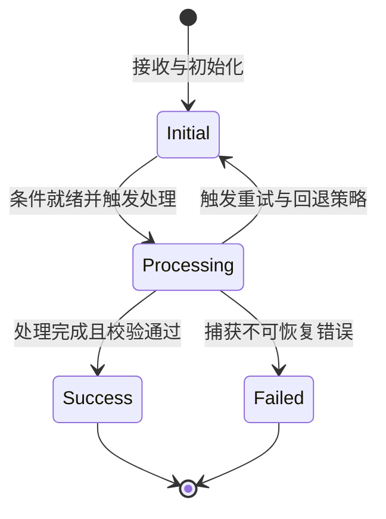

# 04. 核心数据结构与状态不变式

## 目标
建立对核心数据实体、状态演进与系统不变式的建模方法论。探究软件系统数据结构与状态契约背后的基本真理，梳理状态演进生命周期、副作用边界与异常自愈保障。

---

## 1. 数据结构决定逻辑走向

如 Linus Torvalds 所言：“烂程序员关心代码，好程序员关心数据结构及其关系”。  
如果搞不清核心数据实体长什么样，代码逻辑就会显得像一团散沙；一旦看透了核心实体与状态转移，上层纷繁复杂的控制流就会瞬间变得顺理成章。

---

## 2. 状态不变式 (System Invariants)

在阅读承重代码时，最重要的不是看常规赋值，而是识别**系统在任何时刻都必须维持的真理规则**：

1. **有效性与边界不变式**：
   - 核心数据在任何合法时刻都满足其值域与结构完整性约束；
2. **互斥与排他不变式**：
   - 系统的状态不能处于相互矛盾的双重状态（例如：同一实体不能既处于待决状态又处于终止状态）；
3. **因果与时序不变式**：
   - 前置依赖未就绪或未通过校验时，下游状态不得提前跃迁，产物不得提前生成。

---

## 3. 有限状态与生命周期建模 (FSM)

系统中的核心实体通常具有明确的生命周期状态迁移。使用 Mermaid 状态图（`stateDiagram-v2`）进行建模：

在审视状态机时，重点检查：
- **是否存在非法状态跃迁？**（未经验证直接跃迁到完成态）；
- **是否存在未定义或不可退出的死循环卡死状态？**

---

## 4. 状态可变性控制与副作用边界

根据系统对状态的处理方式，审视其对可变性与副作用的控制：
- **无状态与纯计算设计**：若为纯计算或无状态模块，观察其如何通过不可变数据与纯函数消除隐式副作用；
- **状态修改的收敛与封装**：若包含常驻可变状态，观察是否通过受控的收敛入口进行修改，防止外界越权随意篡改；
- **多执行流与并发时序控制**：若存在多执行流或异步并发访问共享状态，观察其采用何种协调机制确保时序有序与状态一致。

---

## 5. 关键操作的完整性与自愈恢复

当核心操作执行中途被异常破坏或抛出错误时，状态如何恢复：
- **状态回退与隔离**：执行失败时是回滚未决变更，还是隔离脏数据，防止破损状态污染全局；
- **操作幂等性**：重复传入相同输入或多次执行同一操作时，是否具备防重与幂等保护；
- **不可逆操作的可靠性**：当涉及向外部交付最终产物或持久化固化时，系统如何保证“全或无”，避免留下半成品的损坏状态。
