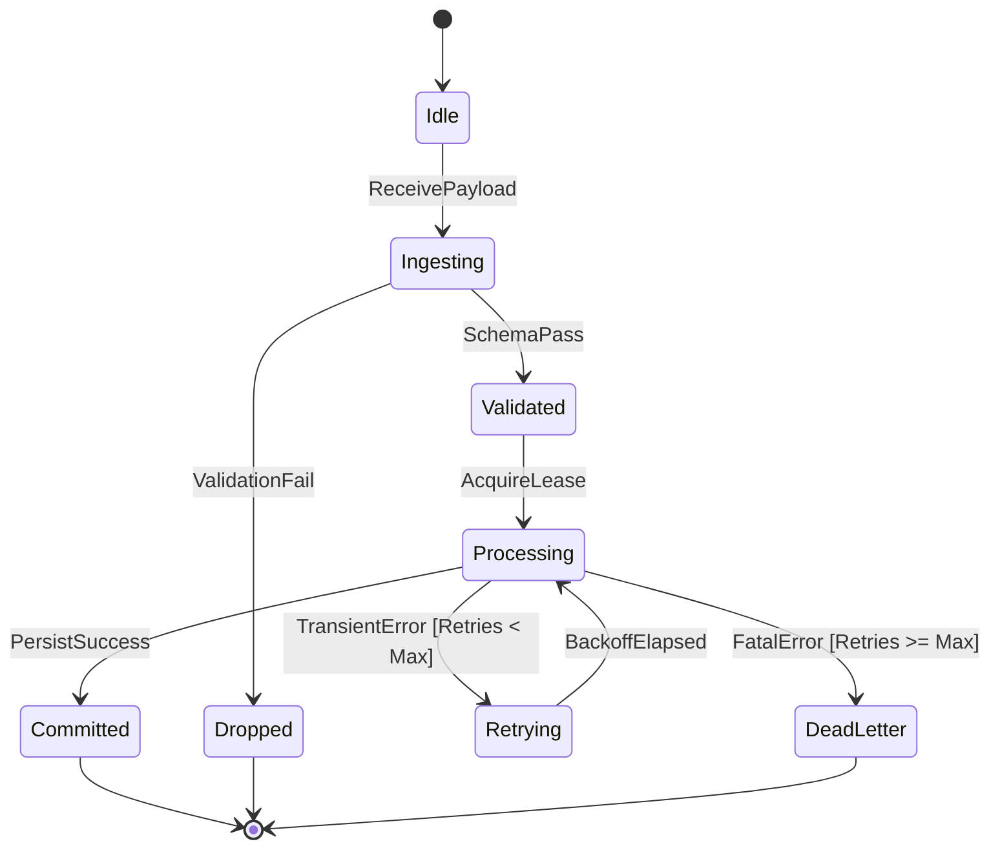

# 05. Core Data Structures & State Machine Invariants

## Objective
Establish a structural modeling methodology focused on domain ontologies, lifecycle state machines, and system invariants. Extract the fundamental truths of a system from memory layout and guard conditions rather than transient call stacks.

---

## 1. Domain Ontology & Keystone Entities

Algorithms are temporary, but data structures define the ceiling of system capability. In any codebase, 2 to 4 keystone entities anchor the entire domain model:

| System Domain | Keystone Entities | Core Field Responsibilities | Lifecycle Ownership |
| :--- | :--- | :--- | :--- |
| **Distributed Storage** | `Segment`, `WALRecord`, `IndexBlock` | Offset bounds, CRC32 checksum, byte payload | Created by active writer; pooled via arena; closed upon segment seal. |
| **Task / Job Engine** | `JobDefinition`, `TaskInstance`, `Lease` | DAG dependencies, state enum, lease expiry, retry count | Created by API ingress; scheduled by engine; garbage-collected on completion. |
| **Vector / AI Agent** | `MemoryRecord`, `EmbeddingVector`, `Session` | Semantic text, dense float array, user ID, timestamp | Persisted in vector index; cached in LRU cache; scoped to user session. |

### Modeling Intent Analysis
When examining a keystone entity, answer three questions:
1. **Memory Representation**: Is it a pointer-heavy linked tree, a flat contiguous array, or a reference-counted structure? (Indicates cache locality and allocation overhead).
2. **Mutability & Concurrency**: Are fields guarded by a mutex (`sync.RWMutex`), atomic primitives (`atomic.Value`), or are they immutable after construction?
3. **Identity vs. Value**: Does the struct represent an entity with a lifecycle ID (UUID, monotonically increasing uint64) or an immutable Value Object?

---

## 2. Lifecycle State Machines & Forbidden Transitions

State fields (e.g., `Status`, `Phase`, `State`) are the most critical control levers in any software system. To understand a system, model its state transitions exhaustively:

```
                      ┌───────────────┐
                      │    PENDING    │
                      └───────┬───────┘
                              │ Task Assigned
                              ▼
                      ┌───────────────┐
         ┌───────────►│    RUNNING    ├────────────┐
         │            └───────┬───────┘            │
         │ Retry              │ Success            │ Fatal Error
         │ (Backoff < Max)    ▼                    ▼
  ┌──────┴──────┐     ┌───────────────┐    ┌───────────────┐
  │  RETRYING   │     │   COMPLETED   │    │    FAILED     │
  └─────────────┘     └───────────────┘    └───────────────┘
```

### The Rule of Forbidden Transitions
The quality of an implementation is defined not just by what transitions it allows, but by **how strictly it forbids illegal transitions**:
- Can an already `COMPLETED` task jump back to `RUNNING`?
- Can a `FAILED` task be acknowledged as succeeded?
- Where in code is this forbidden transition intercepted?

#### Concrete Guard Pattern (Go)
```go
// [pkg/engine/task.go#L112-L128]
func (t *Task) TransitionTo(next State) error {
    t.mu.Lock()
    defer t.mu.Unlock()

    validNext, exists := allowedTransitions[t.current]
    if !exists || !validNext[next] {
        return fmt.Errorf("illegal state transition: %s -> %s (task_id=%s)", t.current, next, t.id)
    }
    t.current = next
    return nil
}
```

---

## 3. System Invariants & Code Anchoring

An **Invariant** is a predicate about system state that must hold true across all operations, concurrent interleavings, and crash recoveries. Identifying invariants reveals what the authors cared about above all else:

### Canonical Invariant Examples & Code Anchoring

1. **Mutual Exclusion Invariant**:
   - *Rule*: "At any instant $t$, an execution lease may be held by at most one worker."
   - *Code Anchor*: Physical atomic compare-and-swap or SQL conditional update:
     `UPDATE leases SET holder = :worker WHERE id = :id AND expiry < :now`
2. **Durability Invariant**:
   - *Rule*: "No mutation shall be acknowledged to the caller before its WAL entry is synced to disk."
   - *Code Anchor*: Synchronous `wal.Sync()` preceding `client.WriteResponse()`.
3. **Monotonicity Invariant**:
   - *Rule*: "A replica's committed index never decreases."
   - *Code Anchor*: Guard check: `if newCommitIndex < r.commitIndex { panic(...) }`.

---

## 4. Mermaid State Diagram Standard

Render state machines in `ARCHITECTURE.md` using `stateDiagram-v2` with the following compliance rules:
- Flush left with margin ````mermaid`.
- Never use C++ `::` scope operators in transition labels (e.g., use `State.ACTIVE` instead of `State::ACTIVE`).
- Explicitly highlight terminal states and rejection branches:



---

## 5. Verification Checklist

Before publishing state models:
- [ ] Are 2–4 keystone entities identified with field-level modeling intent?
- [ ] Is the lifecycle state machine fully mapped with valid triggers?
- [ ] Are illegal transitions identified alongside their guard interception code?
- [ ] Are core invariants cited with physical lock/CAS/transaction code anchors?
- [ ] Does the Mermaid state diagram render cleanly without syntax errors?
