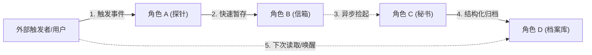

# {{REPO_NAME}} Architecture Blueprint (5-Level Cognitive Zooming Edition)

> **Document Version**: 2.0  
> **Target Ecosystem**: {{ECOSYSTEM}}  
> **Cognitive Framework**: 5-Level Cognitive Zooming (Why ➔ Strategy ➔ Example ➔ Deep-Dive ➔ Takeaway)  
> **Quality Standard**: Zero-Fluff Engineering Standard & AST Fact Grounded

---

## Level 1: Why — Problem Space & First-Principles Tension (为什么存在？)

> 💡 **Cognitive Rule**: 这一节**严禁堆砌内部代码文件名或函数名**！必须用纯粹的业务与工程常识，讲透项目存在的现实依据。

### 1.1 The Real-World Pain Point (现实世界痛点)
- **Without this project (没有它之前有多痛苦)**: 
  - [描述工程师/用户在现实中遇到的真实痛苦、机械重复劳动、生产灾难或能力瓶颈]
- **The Core Mission (项目的核心使命)**:
  - **What it DOES (只解决什么)**: [一句话明确系统边界]
  - **What it DOES NOT (坚决不碰什么)**: [明确不解决什么，防止认知发散]

### 1.2 The First-Principles Tension (系统的第一性技术矛盾)
所有的优秀架构都是为了化解核心冲突而生的。本系统面临的根本矛盾是：
- **Tension Axis (矛盾轴心)**: `[需求A: 例如终端无阻塞极速响应]` **VS** `[需求B: 例如断电不丢数据的持久化保证]`
- **The Dilemma (为什么简单做法会死)**:
  - 如果采用最简单的朴素做法（如同步阻塞写），会导致：[崩溃/性能灾难]；
  - 如果直接异步忽略，会导致：[数据不一致/数据丢失]。
- **The Architectural Mission**: 下文所有的模块划分与算法设计，**100% 是为了在代码层面化解这一矛盾**。

---

## Level 2: Strategy — Metaphor, Cast & Macro Topology (大体怎么做的？)

> 💡 **Cognitive Rule**: 建立高维心智模型。全系统只抽象出 3~5 个核心角色，讲清协作骨架。

### 2.1 The Real-World Metaphor (一句话现实隐喻)
> 用生活常识打比方：整个系统本质上就像是：**[生活中的隐喻，例如：潜伏在终端里的速记员 + 后台常驻的机要秘书 + 本地保险柜]**。

### 2.2 The Cast of Characters (剧本角色分工表)
系统无论多大，核心角色永远只有几个：

| 剧本角色 | 现实人话身份 | 承担的单一职责 | 对应的核心目录 / 文件 | 运行形态 (进程/线程) |
| :--- | :--- | :--- | :--- | :--- |
| **角色 A (例: 探针)** | 潜伏在入口的速记员 | 零感知截获输入，极速退出，绝不卡主流程 | `[src/cli/]` | 短命 CLI 进程 |
| **角色 B (例: 信箱)** | 防崩溃的暂存信箱 | 磁盘原子落盘，断电不坏，保证全或无 | `[src/shared/spool/]` | 磁盘持久化目录 |
| **角色 C (例: 秘书)** | 后台提炼的大脑 | 异步排队，过滤降噪，调用模型提炼经验 | `[src/services/worker/]` | 常驻 Sidecar 守护进程 |
| **角色 D (例: 档案库)** | 终身记忆的存储库 | 结构化索引、去重、提供全文与向量检索 | `[src/services/db/]` | 本地 SQLite / WAL 引擎 |

### 2.3 Macro Flowchart (粗线条协作骨架)


---

## Level 3: Concrete Walkthrough — A Day in the Life of Data (举个真实例子跑一遍)

> 💡 **Cognitive Rule**: 读者在看具体代码前，必须看到一份**真实具体的数据**在各组件间流转变形的全过程。

### 3.1 The Scenario (选定单一典型具象用例)
- **Concrete Input Event (具体的输入事件)**:
  ```json
  // 例如：用户在终端敲下了一句特定命令或产生了一次报错
  {
    "event": "ToolUseFailure",
    "command": "npm test",
    "raw_output": "Error: Node version mismatch. Expected >=20, got 18."
  }
  ```

### 3.2 Step-by-Step Data Journey (端到端数据旅程)

#### Step 1: 角色 A 接收与脱敏
- **发生在哪里**: 角色 A 入口处。
- **数据发生了什么变化 (Payload Diff)**:
  - 剥离大体积无关日志，生成轻量凭证，打上单调递增时间戳。
- **关键动作**: 探针立刻退场退出，耗时 `< 20ms`。

#### Step 2: 角色 B 原子落盘
- **发生在哪里**: 暂存信箱。
- **数据形态**: 变成了磁盘上的命名文件 `event-171890123-abc.json`。
- **安全保障**: 采用临时文件 + 重命名机制，即使此刻按下 `Ctrl+C` 也能确保文件不损坏。

#### Step 3: 角色 C 异步处理与加工
- **发生在哪里**: 后台守护进程。
- **处理过程**: 守护进程被唤醒，读入该 JSON，提取报错本质，生成结构化摘要：
  `"Key finding: project requires Node >= 20"`。

#### Step 4: 角色 D 持久化与索引
- **发生在哪里**: 本地数据库。
- **最终落地形态**: 插入数据库主表，建立全文索引与唯一哈希指纹，防止重复记录。

---

## Level 4: Deep Dive — Algorithms, State Machines & Code Anchors (细节算法与代码实现)

> 💡 **Cognitive Rule**: 用户此时已建立完整心智，带着强烈的求知欲深入微观代码。所有结论必须强绑定真实源码。

### 4.1 Keystone Structures & Invariants (核心数据结构与状态机)
- **Primary Domain Entity**: 
  - File anchor: `[path/to/file.ext#Lstart-Lend]`
  - Key fields & invariant constraints (哪些字段互斥、哪些字段单调递增).
- **State Transition Machine**:
  ```mermaid
  stateDiagram-v2
      [*] --> Draft
      Draft --> Committed: Validation Passes
      Draft --> Quarantined: Malformed Payload
      Committed --> [*]
  ```

### 4.2 Core Algorithms Solving the First Tension (攻克第一性矛盾的核心算法)
- **Algorithm Problem**: [说明作者是用什么算法解决 Level 1 提出的矛盾]
- **Algorithm Walkthrough**:
  - 算法核心数学公式 / 状态演进逻辑
  - 时间与空间复杂度分析
- **Verified Code Implementation (真实代码证据)**:
  - Location: `[path/to/core_algo.ext#L100-L145]`
  - 关键代码逐行剖析与调用栈。

### 4.3 Limit Scenarios & Defensive Engineering (极限场景与灾难防御)
- **What-If 灾难推演 1 (例如: 突然断电 / SIGKILL 强杀)**:
  - 潜在破坏: [如果不防，会造成什么灾难]
  - 源码防御解法: `[path/to/defense.ext#L50-L75]` 展示作者是如何利用系统调用/事务自愈的。
- **What-If 灾难推演 2 (例如: 上游 API 429 欠费限流 / 队列堆积)**:
  - 源码防御解法: 展示背压策略、指数退避重试或动态熔断机制。

---

## Level 5: Takeaway — Architecture Trade-offs & Transposable Patterns (权衡与可迁移模式)

> 💡 **Cognitive Rule**: 升华认知，提炼出可直接用于个人未来工程设计的思想武器。

### 5.1 Architecture Trade-offs Audit (架构得失权衡)
优秀的架构师从不声称“完美”，而是懂得取舍：

| 获得的优势 (Gained) | 付出的代价 (Sacrificed) | 为什么这个取舍在当前场景是明智的？ |
| :--- | :--- | :--- |
| **绝对的终端零卡顿** | 牺牲了毫秒级强实时性（后置异步提炼，存在秒级延迟） | 开发者敲代码需要瞬时反馈，多等 100ms 就会烦躁，但提炼记忆延迟 2 秒毫无影响。 |
| **轻量级零额外依赖** | 牺牲了分布式跨机器共享能力（仅限本地 SQLite） | 单人桌面环境不需要部署集群，单机开箱即用体验价值更高。 |

### 5.2 Transposable Patterns (我能偷学到什么？)
- **Pattern 1**: [例如：Crash-safe 原子文件写入范式，可以直接搬到自己任何 CLI 脚本中]
- **Pattern 2**: [例如：单单调队列去重策略，可以用在自己的日志收集代理中]
