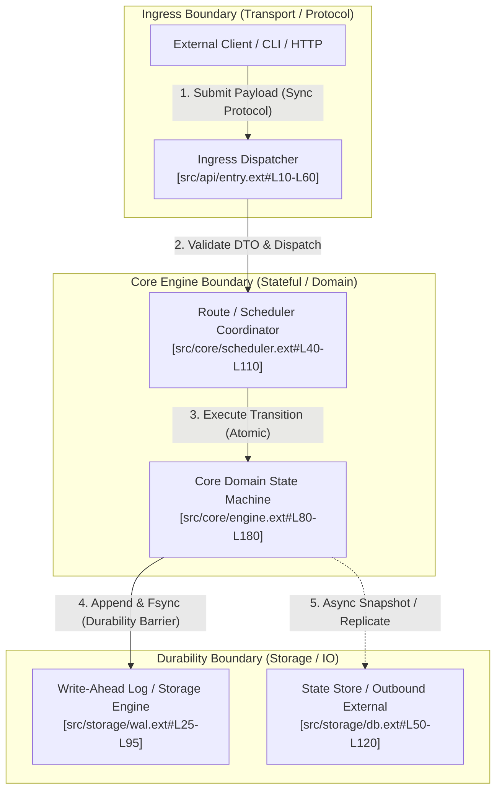
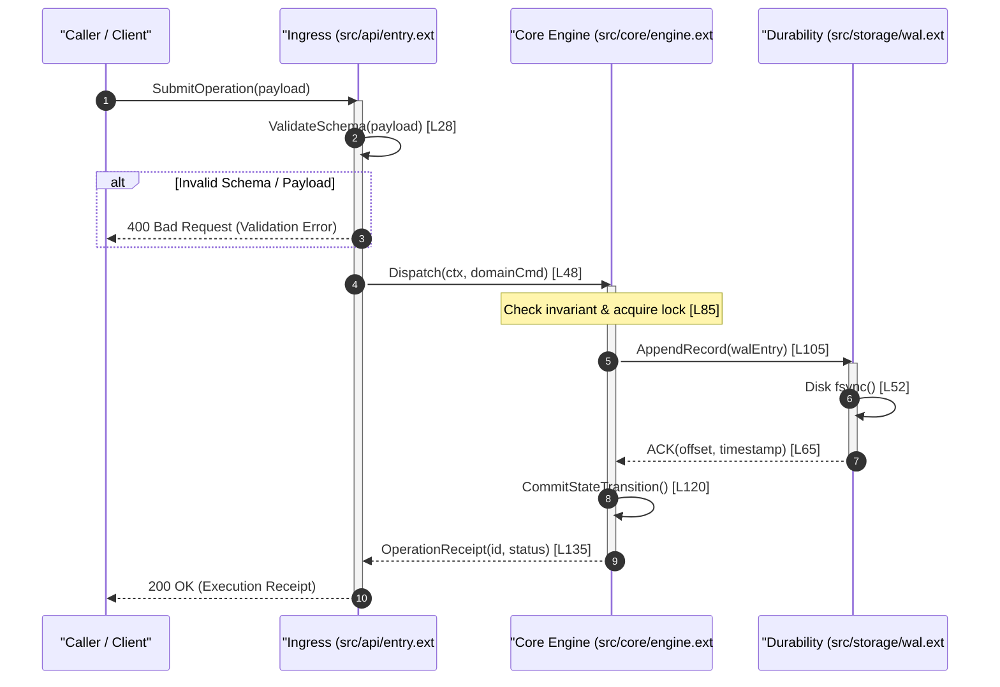
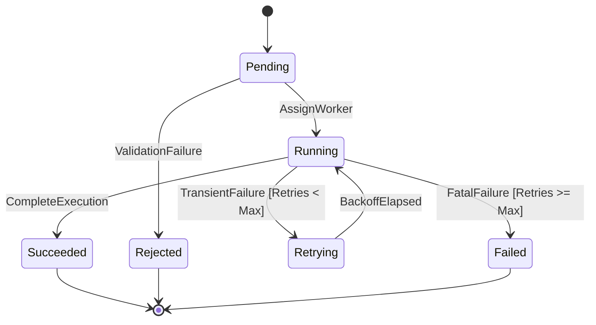

# [Project Name] Architecture Blueprint (Architecture Specification)

> **Document Version**: 1.0  
> **Target Ecosystem**: `[Language]` / `[Primary Framework]`  
> **Macro Pattern**: `[Microkernel / Pipes & Filters / Event-Driven / Layered DDD / WAL+State Machine / Workflow]`  
> **Evaluation Standard**: GitHub High-Star Anti-AI Standard (100-Point Rubric Compliant)

---

## 1. System Positioning & Core Engineering Mission

### 1.1 Problem Statement & Value Proposition
- **Core Engineering Problem**: [Precise 2-3 sentence statement explaining what fundamental computing or business bottleneck this system solves].
- **System Inputs & External Triggers**: [CLI flags, REST/gRPC endpoints, message queues, Kafka streams, filesystem events].
- **Terminal Outputs & Side Effects**: [Durable database mutations, structured stdout/stderr, network RPC acknowledgements, disk WAL segments].
- **External Dependencies & Infrastructure**: [Operating system syscalls, database engines, third-party APIs, distributed key-value stores].

### 1.2 Macro Architectural Topology

---

## 2. Module Reading Priority & Triage Matrix

Every directory and package in the codebase is triaged into three priority tiers to direct deep reading focus to the load-bearing domain core:

| Module / Directory Path | Priority Tier | Domain Responsibility & Scope | Core Logic? | Dependency Direction & Interfaces |
| :--- | :---: | :--- | :---: | :--- |
| `[src/core/engine/]` | **Tier-0** | [Core state machine, invariant guards, scheduling loop] | **Yes** | Inward only; zero dependency on transport or raw storage drivers. |
| `[src/storage/wal/]` | **Tier-0** | [Append-only transaction logging, disk flush, recovery replay] | **Yes** | Implements core durability interface; called by core engine. |
| `[src/api/handlers/]` | **Tier-1** | [HTTP/gRPC route dispatch, deserialization, auth tokens] | No | Depends on `src/core/`; translates incoming DTO to domain commands. |
| `[src/storage/adapters/]`| **Tier-1** | [Driver adapters for specific external databases] | No | Implements storage interfaces defined by Tier-0. |
| `[cmd/cli/]` | **Tier-2** | [CLI flag parsing, environment bindings, signal trapping] | No (Glue) | Ingress launcher; instantiates dependencies. Skim quickly. |
| `[src/utils/]` | **Tier-2** | [String manipulation, formatting helpers, math utilities] | No (Glue) | Pure leaf utility; filtered to preserve cognitive bandwidth. |

---

## 3. The Golden Path: End-to-End Execution Flow

### 3.1 Canonical Scenario: [e.g. Single Task Submission to Durable State Transition]
Follows the 5-phase golden execution path: `Ingress -> Dispatch -> Engine -> Persistence/IO -> Response`.

### 3.2 Verified Code Anchors Along the Golden Path
- **Ingress Decoding & Validation**: [`[src/api/entry.ext#L20-L35]`](file:///[absolute_path]#L20-L35) — [Verified Fact: Deserializes JSON payload into CommandDTO]
- **Dispatch & Context Injection**: [`[src/core/dispatch.ext#L40-L65]`](file:///[absolute_path]#L40-L65) — [Verified Fact: Injects cancellation deadline and worker lease]
- **Core Domain State Transition**: [`[src/core/engine.ext#L80-L115]`](file:///[absolute_path]#L80-L115) — [Verified Fact: Mutates state enum guarded by mutex]
- **Durable Disk Commit**: [`[src/storage/wal.ext#L35-L60]`](file:///[absolute_path]#L35-L60) — [Verified Fact: Blocks until fsync syscall acknowledges write]

---

## 4. Keystone Entities & State Machine Invariants

### 4.1 Domain Ontology & Keystone Entities
- **`[KeystoneEntity1]`** [`[src/core/types.ext#L15-L45]`](file:///[absolute_path]#L15-L45):
  - *Fields & Intent*: [Explain key fields, ID generation, and memory representations].
  - *Concurrency & Ownership*: [Guarded by mutex / atomic counter / immutable Value Object].
- **`[KeystoneEntity2]`** [`[src/core/state.ext#L50-L85]`](file:///[absolute_path]#L50-L85):
  - *Fields & Intent*: [Explain lifecycle metadata, lease duration, and transition history].

### 4.2 Lifecycle State Machine & Forbidden Transitions

- **Illegal State Transitions**: [e.g. `Succeeded -> Running` or `Failed -> Succeeded`].
- **Code Defense Anchor**: [`[src/core/engine.ext#L130-L142]`](file:///[absolute_path]#L130-L142) — [Verified Fact: State guard throws explicit `IllegalTransitionError`].
- **System Invariants**:
  1. *[Invariant 1]*: [e.g. Lease exclusivity: only one worker holds active lease at time $t$]. Anchor: [`[src/core/lease.ext#L45-L55]`](file:///[absolute_path]#L45-L55).
  2. *[Invariant 2]*: [e.g. WAL-before-Memory: disk fsync precedes memory cache commit]. Anchor: [`[src/storage/wal.ext#L70-L82]`](file:///[absolute_path]#L70-L82).

---

## 5. Architectural Design Trade-offs & Technical Debt Audit

### 5.1 Intentional Design Trade-offs
- **Trade-off 1: [Dimension A] vs. [Dimension B]** (e.g., Latency vs. Durability):
  - *Choice*: [Verified Fact: Why the authors chose Approach X over Alternative Y].
  - *Cost Incurred*: [What performance, memory, or complexity cost was consciously accepted].
- **Trade-off 2: [Dimension C] vs. [Dimension D]** (e.g., Simplicity vs. Extensibility):
  - *Choice*: [Verified Fact: Direct static wiring chosen over dynamic plugin SPI].
  - *Cost Incurred*: [Recompilation required to introduce new transport drivers].

### 5.2 Objective Technical Debt Audit
- **[Engineering Inference] God Object / High-Churn Concentration**:
  - *Location*: [`[src/core/dispatcher.ext#L1-L2500]`](file:///[absolute_path]#L1-L2500).
  - *Observation*: File accumulates 35% of all commit modifications; mixes thread-pool scheduling with HTTP response formatting.
  - *Operational Risk*: Fragile lock interactions; high likelihood of regression during concurrency refactoring.
- **[Engineering Inference] Concurrency Contention / Missing Backpressure**:
  - *Location*: [`[src/core/queue.ext#L85-L100]`](file:///[absolute_path]#L85-L100).
  - *Observation*: Unbounded slice/channel used for task buffering without flow control.
  - *Operational Risk*: Potential OOM under sustained upstream traffic spikes.

---

## 6. Failure Modes, Error Bubbling & Defense-in-Depth

| Failure Mode | Severity | Manifestation / Code Location | Recovery & Rollback Mechanism | Defense Evaluation |
| :--- | :---: | :--- | :--- | :--- |
| **Input Schema Violation** | Low | [`[src/api/validator.ext#L30]`](file:///[path]#L30) | Fast fail with 400 error envelope; zero engine allocation. | **Clean**: Reject at ingress boundary. |
| **Worker Heartbeat Timeout** | Med | [`[src/core/heartbeat.ext#L75]`](file:///[path]#L75) | Lease reclaimed; task returned to `Pending` queue. | **Robust**: Exponential backoff prevents thundering herd. |
| **Disk WAL Sync Failure** | High | [`[src/storage/wal.ext#L110]`](file:///[path]#L110) | State mutation aborted; uncommitted memory transaction rolled back. | **Strict**: Preserves durability invariant. |
| **Process SIGKILL Crash** | Critical | In-flight memory state | Replay durable WAL from last checkpoint on startup reboot. | **Idempotent**: Re-executes uncommitted entries cleanly. |

---

## 7. High-Frequency Git Churn Hotspots

| Rank | File Path | Recent Commits | Net Lines Changed | Primary Responsibility | Architectural Health Assessment |
| :---: | :--- | :---: | :---: | :--- | :--- |
| 1 | `[src/core/engine.ext]` | [N] | [+X / -Y] | [State transition loop] | **Healthy Core**: Core domain evolution. |
| 2 | `[src/common/utils.ext]` | [N] | [+X / -Y] | [Mixed helpers] | **Architectural Debt**: High churn indicates low cohesion. |
