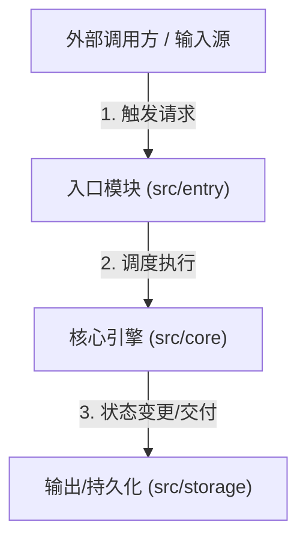

# {{REPO_NAME}} 架构全景白皮书

> **目标语言生态**: {{ECOSYSTEM}}  
> **文档版本**: 2.0  
> **质量标准**: 基于源码事实强锚定与客观推演

---

## 1. 项目使命与现实价值

### 1.1 现实痛点 (Real-World Agony)
- **没有该项目前的困境**: [描述工程师/用户在现实中遇到的实际痛苦、低效瓶颈、机械重复或生产风险]
- **核心定位与边界**:
  - **核心解决**: [一句话明确系统边界与核心目标]
  - **不解决什么**: [明确系统的非目标，防止职责发散]

### 1.2 系统黑盒契约
- **输入事件**: [进入系统边界的数据、请求、事件或配置]
- **交付产物**: [系统最终交付的核心结果、数据形态或服务响应]
- **状态副作用**: [系统在外部或持久化介质留下的关键状态改变]

### 1.3 核心技术矛盾与独特解法
- **调和的核心技术冲突**: [例如：极速低延迟响应 vs 断电不丢数据；轻量零外部依赖 vs 全格式丰富语义]
- **朴素方案为何崩溃**: [如果用 30 行朴素脚本写，系统会在什么极端场景下失败]
- **系统的核心解法**: [系统通过什么关键机制或架构取向化解这一矛盾]

---

## 2. 怎么快速跑起来验证？（开箱即验）

### 2.1 极简构建与安装
```bash
# 1. 依赖安装 / 本地构建命令
[例如: go build -o bin/server ./cmd/server 或 pip install -e .]
```

### 2.2 代表性冒烟单测
挑选 1~2 条覆盖核心路径的单测命令（带精准过滤参数，避免运行耗时全量测试）：
```bash
# 2. 核心路径快速验证命令
[例如: pytest tests/core/test_engine.py -k "test_dispatch" -vv -s]
```

---

## 3. 代码全景与模块分工

### 3.1 核心入口与物理目录映射
系统核心模块与真实代码目录职责划分：

| 模块名称 | 核心职责 (人话说明) | 对应物理路径 | 运行形态 / 边界 |
| :--- | :--- | :--- | :--- |
| **[模块 A]** | [负责拦截初始输入、参数解析或环境初始化] | `[src/entry/]` | [CLI / 控制器 / 进程入口] |
| **[模块 B]** | [承载核心逻辑规则、主线流程推进或核心计算] | `[src/core/]` | [核心引擎 / 调度器] |
| **[模块 C]** | [负责状态保持、外部交互或持久化固化] | `[src/storage/]` | [存储层 / 外部适配] |

### 3.2 架构流向图 (Mermaid)


### 3.3 核心特性深度展开
> 💡 根据项目实际天然亮点深入展开（若偏算法展开计算流与数据变换，若偏系统展开调度与状态机，若偏规则展开约束与执行链路）：

- **核心机制原理**: [详细解析该项目最核心亮眼的机制实现]
- **真实代码证据**:
  - 核心实现锚点: `[path/to/core_file.ext#L100-L150]`
  - 关键数据结构与状态约束。

---

## 4. 推荐切入路线与演进热点

### 4.1 Git 活跃热点文件 (Top-10 Hotspots)
基于近期提交频次，定位系统演进最活跃的承重核心文件：
- `[path/to/hotspot_1.ext]` (高频修改: 承载核心调度/算法)
- `[path/to/hotspot_2.ext]` (高频修改: 状态处理与边界防御)

### 4.2 渐进式代码阅读路线
1. **第一站：入口与上下文装配** `[path/to/entry.ext#Lxx-Lyy]` — 观察外部输入如何解析并封装为上下文对象；
2. **第二站：核心推进逻辑 / 调度器** `[path/to/core.ext#Lxx-Lyy]` — 观察主执行主线、状态流转与关键决策；
3. **第三站：高频变更业务逻辑** `[path/to/hotspot.ext#Lxx-Lyy]` — 研读近期提交最频繁修改的代码实现。

### 4.3 关键调试断点推荐
在本地调试跟踪执行流时，推荐在以下位置设置断点：
- **断点 1 (输入接入)**: 设在 `[path/to/entry.ext:Lxx]`，单步观察入参初始解析与校验；
- **断点 2 (核心决策)**: 设在 `[path/to/core.ext:Lyy]`，单步观察状态变化或计算结果。

---

## 5. 架构权衡与设计取舍 (Trade-offs)

优秀的架构源于权衡与取舍：

| 获得的优势 (Gained) | 付出的代价 (Sacrificed) | 为什么该取舍在当前场景是明智的？ |
| :--- | :--- | :--- |
| **[关键优势 1]** | [对应代价 1] | [原因与场景合理性说明] |
| **[关键优势 2]** | [对应代价 2] | [原因与场景合理性说明] |
