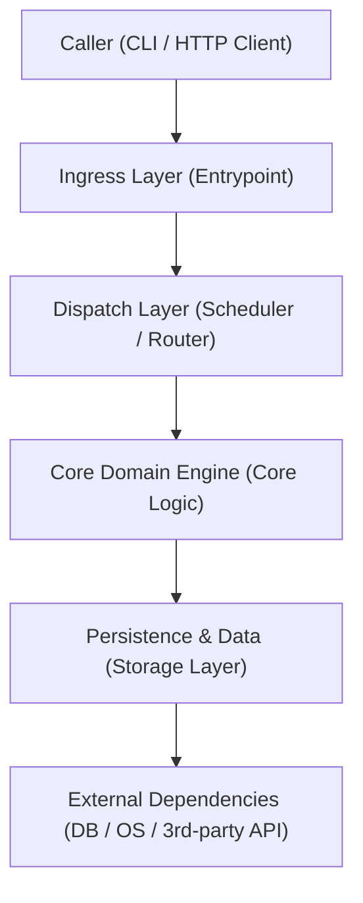
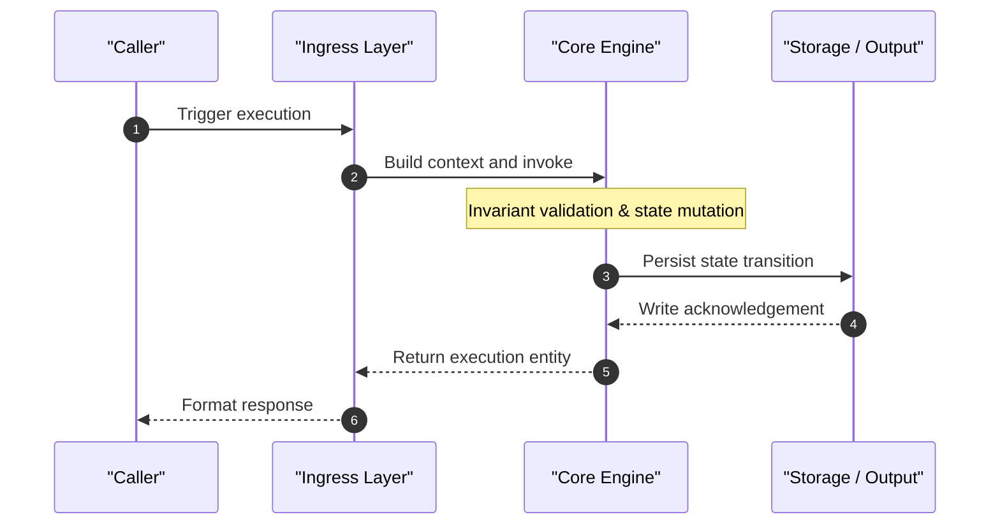
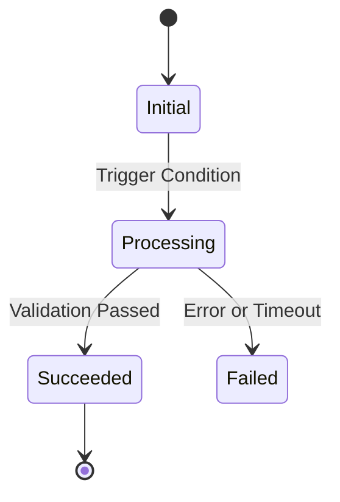

# [Project Name] Architecture Specification (Architecture)

> Document Version: 1.0  
> Technology Stack: [Primary Language] / [Core Framework]  
> Architecture Pattern: [Microkernel / Pipes & Filters / Event-Driven / Layered / Workflow]

---

## 1. System Overview

### Core Functionality & Positioning
[Concise summary of the problem this project solves, primary inputs, and output states.]

### Architectural Topology

---

## 2. Module Responsibilities & Boundaries

| Directory / Module Path | Layer | Core Responsibility | Core Engine? | Dependency Direction |
| :--- | :--- | :--- | :---: | :--- |
| `[Directory 1]` | Ingress | [Argument parsing & request context building] | No (Glue) | Calls Core Engine |
| `[Directory 2]` | Core Engine | [Business invariants & state transitions] | **Yes** | Inward only, no reverse deps |
| `[Directory 3]` | Storage Adapter | [Persistence & external storage wrappers] | No (Peripheral) | Implements core abstract interface |

---

## 3. Key Call Chains

### Golden Path Scenario: [Feature Name, e.g. Single Task Execution]

### Verified Code Anchors
- Parameter validation: [`[path/to/file#Lstart-Lend]`](file:///[absolute_path]#Lstart-Lend)
- Core processing loop: [`[path/to/file#Lstart-Lend]`](file:///[absolute_path]#Lstart-Lend)
- State persistence: [`[path/to/file#Lstart-Lend]`](file:///[absolute_path]#Lstart-Lend)

---

## 4. Core Data Structures & State Machines

### Core Entities
- `[Entity Name]`: [`[path/to/file#Lxx]`](file:///[absolute_path]#Lxx) — [Key fields and business modeling intent]

### State Machine Transitions

---

## 5. High-Frequency Modification Files (Git Churn Hotspots)

| Rank | File Path | Recent Commits | Lines Changed | Architectural Significance |
| :---: | :--- | :---: | :---: | :--- |
| 1 | `[File 1]` | [N] | [N] | [Reason for frequent modifications] |
| 2 | `[File 2]` | [N] | [N] | [Reason for frequent modifications] |
