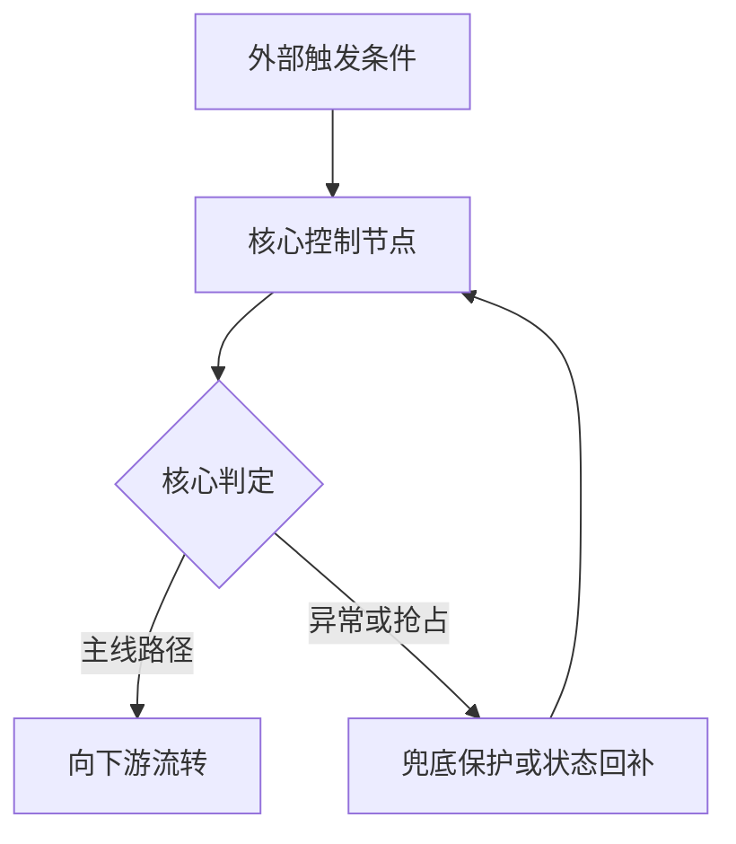

# {{灵活主标题：用大白话点出项目定位或核心价值，不要每次套同一句式}}

> {{副标题标签：开源项目实战拆解 · 第一视角阅读笔记}}

[第一视角自由开篇：直接从读这个项目的契机、代码规模或它解决的最抓人痛点聊起。严禁每次都用一模一样的固定开场白，要像跟朋友聊刚研究透的一个好项目那样自然切入。先用一两句话点出你觉得最值钱、最核心的几个底层设计，然后再交代整篇文章会按从核心到外围的重要程度挨个掰开讲。]

---

## 1. 项目背景、解决的问题、行业现状

[按痛点致命程度从高到低梳理真实背景。注意用接地气的业务场景讲话，别端架子：]

1. **【最核心痛点：关于主引擎/核心状态/致命崩溃】**：[说明如果不解决这个，跑真实场景时会具体出什么洋相]。
2. **【高频刚需痛点：关于持久化/上下文/协同】**：[对比常规重型方案（例如直接堆数据库或全量覆盖）为什么在实际用起来会变笨重或踩坑]。
3. **【成本与性能痛点】**：[算笔具体的账，或者举个资源损耗的直观例子]。
4. **【外围体验痛点】**：[界面交互、热更新或扩展门槛]。

[最后自然收一句，点清这个项目到底管哪一块、不管哪一块。]

---

## 2. 项目特色

[按重要性由重到轻，挑出 3~4 个最有辨识度的设计取舍来聊，别写得像官方宣传文案：]

1. **【核心特色 1】**：[为什么作者不按常规出牌？这样写到底稳在哪里？]
2. **【核心特色 2】**：[放弃了什么看似标准的方案，换来了什么极简收益？]
3. **【核心特色 3】**：[在容易出岔子的不确定环节，代码里怎么用硬规则死死兜底？]
4. **【核心特色 4（外围与细节）】**：[顺带一提那些打磨到毛细血管的加分项]。

---

## 3. 核心功能

[把研读透彻的核心模块按由重到轻排开（`3.1`, `3.2`, ...）。各小节的小标题和过渡语气应随当前模块的风格灵活变化，不要每节硬套一模一样机械重复的固定副标题。]

### 3.1 【最核心模块名称】 (`{{MODULE_PATH}}`)

[用贴近直觉的比喻或具体麻烦引出设计原理，附上核心源码锚点。]

*(绘图要求：单栏阅读报告内一律优先使用 `flowchart TD` 竖向布局且适当 `\n` 折行，避免超宽 `LR` 图在窄屏或公众号里文字缩得太小；编译时会自动转为高清 PNG 图片以适配富文本复制。)*

#### [自由拟定贴合该模块的场景小标题，如：跑一遍真实业务流 / 看看数据怎么流过去的]
1. **【起手触发】**：[结合真实输入样本描述]。
2. **【关键转变】**：[说清数据流经这里发生了什么真实变动与状态校验]。
3. **【最终落点】**：[交付给谁、副作用是什么]。

#### [自由拟定贴合该模块的提问小标题，如：顺手聊聊几个容易犯迷糊的点 / 几个必考的边界坑]
1. **【直接引用或还原当时真实卡壳过的问题 1】**
   [大白话复盘因果，对比反面例子（如果不这么写，具体会在哪报什么错）。]
2. **【问题 2】**
   [针对边界条件、并发或极端输入的解答。]

*(可选用单段 `>` 引用块放一句精华总结，避免把长段列表全塞进引用块里。)*

---

## 写在最后

[用平实自然的口吻收拢全局：再帮读者拎一遍全篇最核心的那 2~3 条主干认知（哪些才是真正的命门、哪些是锦上添花），让没看过源码的人读完也能带走清晰的框架地图。]
